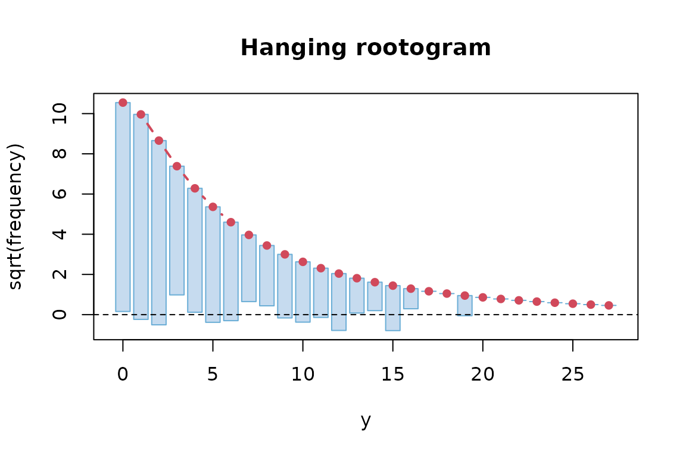

# Count data models

``` r

library(regcompR)
#> 
#> Attaching package: 'regcompR'
#> The following object is masked from 'package:base':
#> 
#>     capabilities
length(families("count"))
#> [1] 51
```

The count families cover the main models of the count data literature:
Poisson, NB1, NB2, NB-P, generalized Poisson, Conway Maxwell Poisson,
Poisson inverse Gaussian, Poisson lognormal, Sichel, Delaporte,
generalized Waring, Faddy’s EPPM, and their zero truncated, zero
inflated and hurdle variants.

## Overdispersion

``` r

n <- 500
d <- data.frame(x = rnorm(n), expo = runif(n, 1, 3))
d$y <- rnbinom(n, mu = d$expo * exp(0.3 + 0.5 * d$x), size = 1.5)
fp <- regcomp(y ~ x + offset(log(expo)), family = "poisson", data = d)
fnb <- regcomp(y ~ x + offset(log(expo)), family = "nb2", data = d)
fnb1 <- regcomp(y ~ x + offset(log(expo)), family = "nb1", data = d)
AIC(fp, fnb, fnb1)
#>      df      AIC
#> fp    2 2559.582
#> fnb   3 2162.930
#> fnb1  3 2194.417
plot(fnb, which = "rootogram")
```



Dispersion can depend on covariates:

``` r

fnb_phi <- regcomp(y ~ x + offset(log(expo)), phi ~ x, family = "nb2", data = d)
coef(fnb_phi)
#>  mu:(Intercept)            mu:x phi:(Intercept)           phi:x 
#>     0.351055641     0.510569126     0.528786459    -0.005336546
```

## Excess zeros

``` r

d$yz <- ifelse(runif(n) < plogis(-1 + d$x), 0, d$y)
fzi <- regcomp(yz ~ x, zi ~ x, family = inflate("nb2"), data = d)
fhu <- regcomp(yz ~ x, hu ~ x, family = hurdle("nb2"), data = d)
AIC(fzi, fhu)
#>     df      AIC
#> fzi  5 1689.792
#> fhu  5 1683.325
predict(fzi, data.frame(x = c(-1, 1)), type = "probability", at = 0)
#>      probability(0)
#> [1,]      0.4427475
#> [2,]      0.5988394
```

## Exact and quantile methods

Exact conditional Poisson inference for small samples:

``` r

exact_poisson(y = c(0, 1, 3, 4, 6), x = c(0, 0, 1, 1, 1), exposure = c(10, 12, 9, 11, 10))[c("estimate", "p_value", "conf_int")]
#> $estimate
#> [1] 2.254794
#> 
#> $p_value
#> [1] 0.006212928
#> 
#> $conf_int
#> [1] 0.3590072 6.0042453
```

Quantile regression for counts by jittering (needs quantreg):

``` r

q <- quantile_count(y ~ x, d, tau = 0.75, m = 20)
q$coefficients
#> (Intercept)           x 
#>    1.358678    0.535788
```
