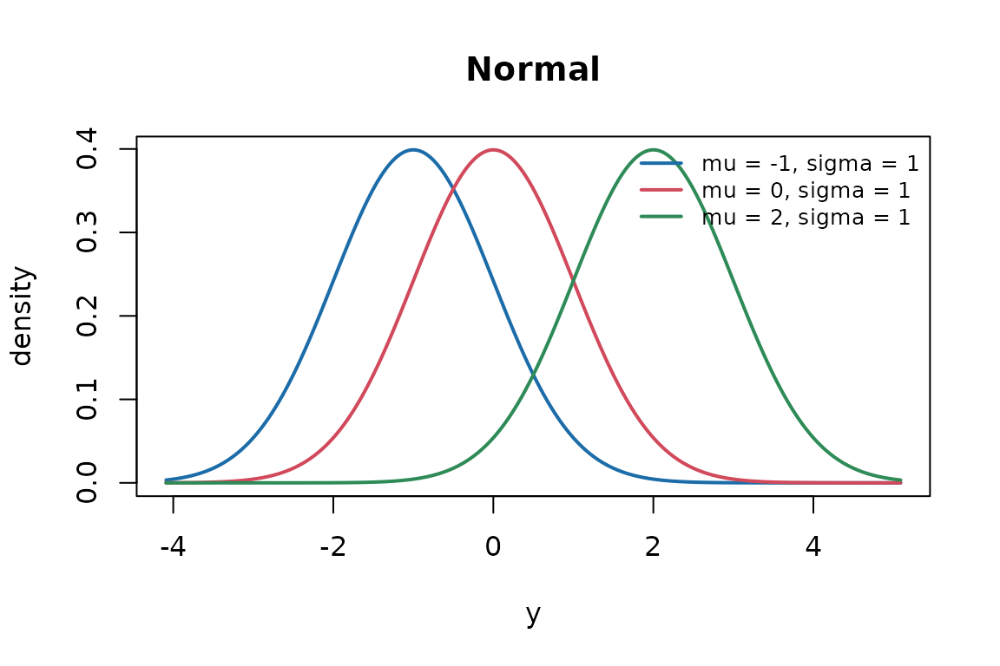
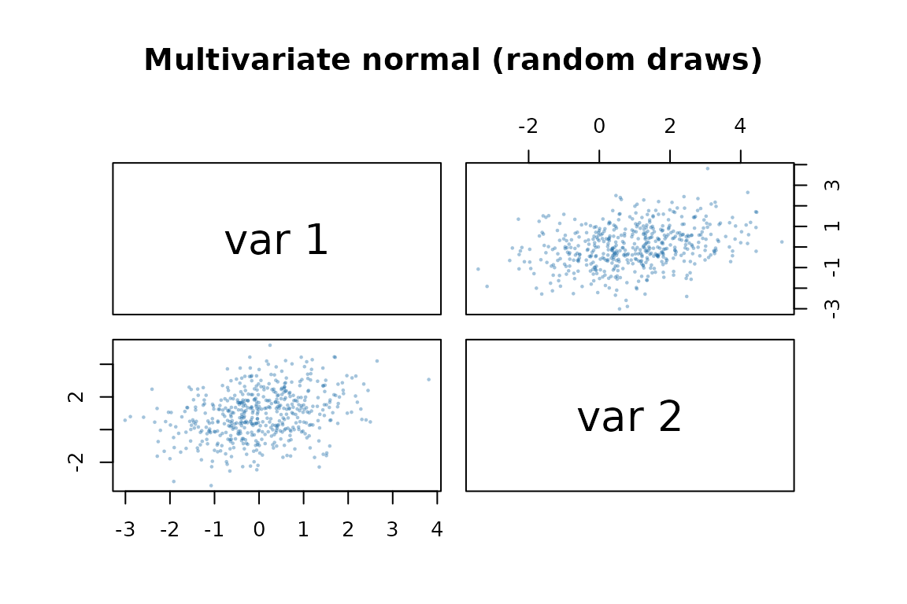

# Distributions and the registry

``` r

library(regcompR)
```

## The registry

Every family is an entry of a registry that records its support,
parameters (domain, role, default link, interpretation), formulas,
moments, references and which methods and engines support it.
[`families()`](https://adamrsophie.github.io/regcompR/reference/get_family.md)
lists identifiers, optionally by category or status;
[`registry_table()`](https://adamrsophie.github.io/regcompR/reference/registry_table.md)
gives one row per family;
[`get_family()`](https://adamrsophie.github.io/regcompR/reference/get_family.md)
returns the family object.

``` r

reg <- registry_table()
table(reg$category)
#> 
#>                bounded            categorical               circular 
#>                     35                      3                     10 
#>                  count            directional        finite_discrete 
#>                     51                      4                     16 
#>                  mixed           multivariate                ordinal 
#>                      2                     22                     10 
#>               positive quantile_parameterized                   real 
#>                     64                      5                     56
head(reg[, c("id", "category", "parameters", "status", "cdf", "stan")])
#>                        id category      parameters    status         cdf
#> 1 adjacent_category_logit  ordinal mu, cuts, scale validated unavailable
#> 2                 arcsine  bounded            a, b validated    analytic
#> 3      asymmetric_laplace     real  mu, sigma, tau validated    analytic
#> 4         axial_von_mises circular       mu, kappa validated     numeric
#> 5         balding_nichols  bounded            F, p validated    analytic
#> 6                   bates  bounded               n validated    analytic
#>          stan
#> 1   generated
#> 2 unavailable
#> 3   generated
#> 4 unavailable
#> 5 unavailable
#> 6 unavailable
families("circular")
#>  [1] "axial_von_mises"   "cardioid"          "dirac_comb"       
#>  [4] "henyey_greenstein" "mie"               "nnts"             
#>  [7] "projected_normal"  "von_mises"         "wrapped_cauchy"   
#> [10] "wrapped_normal"
get_family("nb2")
#> <regcomp_family negative_binomial_nb2> Negative binomial (NB2)
#>   category: count, variate: scalar, discrete, status: validated
#>   parameters:
#>     mu       positive          link log       [mean]
#>     phi      positive          link log       
#>   formula: p(y) = C(y + phi - 1, y) (mu / (mu + phi))^y (phi / (mu + phi))^phi
```

The categories are `"real"`, `"positive"`, `"bounded"` (unit interval
and other bounded supports), `"count"`, `"finite_discrete"`,
`"ordinal"`, `"categorical"`, `"circular"`, `"directional"` (spheres),
`"multivariate"` (vectors and matrices), `"mixed"` (continuous laws with
point masses, such as the Tweedie law) and `"quantile_parameterized"`
(metalog and J-QPD laws).

Several parameterizations of a law are separate entries. The
`parameterization` argument of
[`get_family()`](https://adamrsophie.github.io/regcompR/reference/get_family.md)
and
[`regcomp()`](https://adamrsophie.github.io/regcompR/reference/regcomp.md)
selects one by suffix:

``` r

names(get_family("gamma")$pars)                  # mean and coefficient of variation
#> [1] "mu"    "sigma"
names(get_family("gamma", "rate")$pars)          # shape and rate
#> [1] "shape" "rate"
names(get_family("weibull", "mean")$pars)
#> [1] "mu"    "sigma"
```

## Capabilities

[`family_capabilities()`](https://adamrsophie.github.io/regcompR/reference/family_capabilities.md)
reports how each operation is provided: `"analytic"` (written for the
family: a closed form, or a series, recursion or quadrature specific to
it), `"numeric"` (the generic numerical fallback) or `"unavailable"`,
together with regression and engine support.
[`supports()`](https://adamrsophie.github.io/regcompR/reference/family_capabilities.md)
answers one question.

``` r

str(family_capabilities("conway_maxwell_poisson"))
#> List of 16
#>  $ log_prob  : chr "analytic"
#>  $ cdf       : chr "analytic"
#>  $ quantile  : chr "numeric"
#>  $ rng       : chr "numeric"
#>  $ mean      : chr "analytic"
#>  $ variance  : chr "analytic"
#>  $ skewness  : chr "numeric"
#>  $ kurtosis  : chr "numeric"
#>  $ score     : chr "numeric"
#>  $ hessian   : chr "numeric"
#>  $ regression: logi TRUE
#>  $ ml        : logi TRUE
#>  $ stan      : chr "generated"
#>  $ tmb       : chr "unavailable"
#>  $ bugs      : chr "unavailable"
#>  $ status    : chr "validated"
supports("cauchy", "mean")                       # FALSE: the mean does not exist
#> [1] TRUE
supports("poisson", backend = "stan")
#> [1] TRUE
supports("cumulative_logit", "rng")
#> [1] TRUE
```

## Distribution objects

[`distribution()`](https://adamrsophie.github.io/regcompR/reference/distribution.md)
combines a family with parameter values (scalars or vectors, recycled to
a common length). Parameters are checked against their domains and joint
constraints when the object is created.

``` r

d <- distribution("gamma", mu = 2, sigma = 0.5)
d
#> <regcomp_dist> Gamma (mean and coefficient of variation, GAMLSS GA)
#>   mu = 2
#>   sigma = 0.5
prob(d, c(1, 2, 3))              # density or mass
#> [1] 0.3608941 0.3907336 0.1784702
log_prob(d, c(1, 2, 3))          # log density, computed on the log scale
#> [1] -1.0191707 -0.9397292 -1.7233339
cdf(d, 2); survival(d, 2)
#> [1] 0.5665299
#> [1] 0.4334701
quantile(d, c(0.1, 0.5, 0.9))
#> [1] 0.8723848 1.8360304 3.3403915
rng(d, 5)
#> [1] 1.213062 3.214959 3.142633 2.159352 3.104412
c(mean = mean(d), variance = variance(d), skewness = skewness(d), kurtosis = kurtosis(d))
#>     mean variance skewness kurtosis 
#>      2.0      1.0      1.0      1.5
support(d)
#> $lower
#> [1] 0
#> 
#> $upper
#> [1] Inf
#> 
#> $discrete
#> [1] FALSE
try(distribution("gamma", mu = -1, sigma = 0.5))
#> Error in validate_parameters(fam, vals) : 
#>   Parameter 'mu' of 'gamma' must be in its positive domain; got -1.
```

Moments that do not exist are `NA` with a reason; a numerical failure is
`NaN` with a warning of class `regcomp_numerical_warning`.

``` r

mean(distribution("cauchy", mu = 0, sigma = 1))
#> Warning: The mean does not exist for 1 parameter value; NA returned.
#> [1] NA
variance(distribution("student_t", mu = 0, sigma = 1, nu = 1.5))
#> Warning: The variance does not exist for 1 parameter value; NA returned.
#> [1] NA
```

A vector of parameters gives a vector of laws;
[`length()`](https://rdrr.io/r/base/length.html) counts them and `[`
selects some. Parameters that describe one event (a covariance matrix,
the category probabilities of a categorical law) are kept whole.

``` r

dv <- distribution("normal", mu = c(-1, 0, 2), sigma = 1)
length(dv)
#> [1] 3
mean(dv[2:3])
#> [1] 0 2
plot(dv)
```



### Scores and Hessians

[`score()`](https://adamrsophie.github.io/regcompR/reference/score.md)
and
[`hessian()`](https://adamrsophie.github.io/regcompR/reference/score.md)
give the derivatives of the log density with respect to each parameter,
analytically where the family supplies them and by finite differences
that stay inside the parameter domain otherwise.

``` r

dn <- distribution("normal", mu = 0, sigma = 1)
score(dn, c(-1, 0, 2))
#>      mu         sigma
#> [1,] -1  1.554312e-10
#> [2,]  0 -1.000000e+00
#> [3,]  2  3.000000e+00
hessian(dn, 1)[1, , ]
#>              mu sigma
#> mu    -1.000311    -2
#> sigma -2.000000    -2
```

### Validation

``` r

validate_parameters("poisson", list(lambda = 2))
try(validate_parameters("poisson", list(lambda = -2)))
#> Error in validate_parameters("poisson", list(lambda = -2)) : 
#>   Parameter 'lambda' of 'poisson' must be in its positive domain; got -2.
validate_response(distribution("poisson", lambda = 2), c(-1, 0, 1.5, 3))
#> [1] FALSE  TRUE FALSE  TRUE
```

### Point masses and lattices

Each family states its measure. Discrete laws live on a lattice (the
integers, or multiples of a step); continuous laws may carry atoms,
which
[`prob()`](https://adamrsophie.github.io/regcompR/reference/probability-interface.md)
reports as masses at those points and the CDF as jumps.

``` r

tw <- distribution("tweedie", mu = 1, phi = 1, power = 0.5)   # Tweedie power p = 1.5
prob(tw, 0)                          # the atom at zero
#> [1] 0.1353353
tob <- distribution(censor("normal", lower = 0), mu = 0.5, sigma = 1)
c(prob(tob, 0), cdf(tob, -1e-9), cdf(tob, 0))   # an atom and the jump of the CDF
#> [1] 0.3085375 0.0000000 0.3085375
prob(distribution("poisson", lambda = 2), 1.5)  # off the lattice: no mass
#> [1] 0
```

## Families beyond the real line

``` r

vm <- distribution("von_mises", mu = 0, kappa = 2)
prob(vm, c(-pi, 0, pi))
#> [1] 0.009448771 0.515885412 0.009448771
dir <- distribution("dirichlet", alpha = c(2, 3, 5))
rng(dir, 2)
#>           [,1]      [,2]      [,3]
#> [1,] 0.2563794 0.3525245 0.3910961
#> [2,] 0.1101461 0.2610781 0.6287757
mvn <- distribution("multivariate_normal", mu = c(0, 1), Sigma = matrix(c(1, 0.5, 0.5, 2), 2))
log_prob(mvn, rbind(c(0, 1), c(1, 2)))
#> [1] -2.117685 -2.689114
plot(mvn)
```



``` r

try(distribution("multivariate_normal", mu = c(0, 1), Sigma = matrix(c(1, 2, 2, 1), 2)))
#> Error in validate_parameters(fam, vals) : 
#>   Sigma must be positive definite.
mn <- distribution("multinomial", probs = c(0.2, 0.3, 0.5), size = 4)
rng(mn, 2)
#>      [,1] [,2] [,3]
#> [1,]    1    1    2
#> [2,]    1    0    3
ml <- distribution("metalog", a = c(0, 1, 0.2))
quantile(ml, c(0.1, 0.5, 0.9))
#> [1] -2.021447  0.000000  2.373003
```

Multivariate families check their structured parameters (symmetric
positive definite covariance and scale matrices, Wishart degrees of
freedom, orthonormal frames) and the shape of each response. Multinomial
and Ewens laws take the sample size as a parameter.

## Links

[`links()`](https://adamrsophie.github.io/regcompR/reference/link.md)
lists the link functions and
[`link()`](https://adamrsophie.github.io/regcompR/reference/link.md)
returns one; each parameter has a default link and a set of allowed
links that
[`regcomp()`](https://adamrsophie.github.io/regcompR/reference/regcomp.md)
accepts through `links =`.

``` r

links()
#>  [1] "identity"  "log"       "softplus"  "sqrt"      "inverse"   "logit"    
#>  [7] "probit"    "cloglog"   "cauchit"   "loglog"    "tan_half"  "fisherz"  
#> [13] "logshift1" "logshift2"
l <- link("logit")
l$linkinv(0)
#> [1] 0.5
```

## Numerical building blocks

The log scale helpers used throughout the package are exported:

``` r

log1mexp(1e-20)                      # log(1 - exp(-x)) without cancellation
#> [1] -46.0517
log1pexp(800)                        # log(1 + exp(x)) without overflow
#> [1] 800
log_sum_exp(c(1000, 1000))
#> [1] 1000.693
log_diff_exp(log(3), log(2))
#> [1] 2.220446e-16
```

[`vignette("operators")`](https://adamrsophie.github.io/regcompR/articles/operators.md)
shows how to build new families from these, and how to register your
own.
