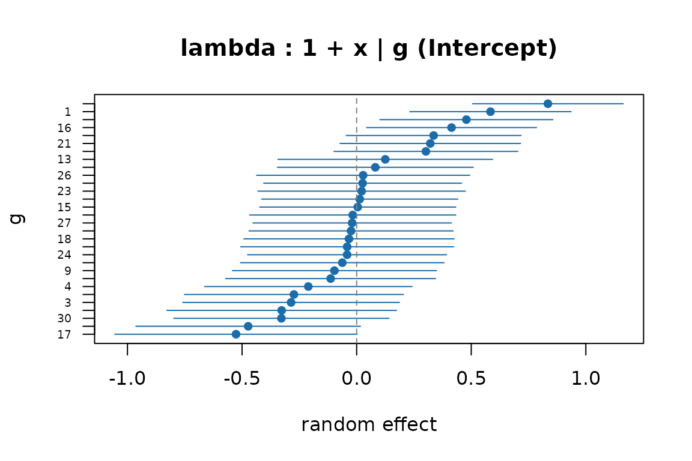

# Hierarchical and longitudinal models

``` r

library(regcompR)
#> 
#> Attaching package: 'regcompR'
#> The following object is masked from 'package:base':
#> 
#>     capabilities
```

Random effects can enter any distribution parameter. Models are fitted
by the Laplace approximation (`engine = "ml"` or the faster
`engine = "tmb"`) or by MCMC (`engine = "bayes"`). Marginal models are
fitted by generalized estimating equations or with cluster robust
covariances.

## Random intercepts and slopes

The syntax follows lme4: `(1 | g)` for a random intercept, `(1 + x | g)`
for correlated intercepts and slopes, `(1 + x || g)` for independent
ones, `(1 | a/b)` for nested and `(1 | a) + (1 | b)` for crossed
factors.

``` r

G <- 30; m <- 8
dat <- data.frame(g = factor(rep(1:G, each = m)), x = rnorm(G * m))
u <- rnorm(G, 0, 0.6); v <- rnorm(G, 0, 0.3)
dat$y <- rpois(G * m, exp(0.5 + (0.4 + v[dat$g]) * dat$x + u[dat$g]))
fit <- regcomp(y ~ x + (1 + x | g), family = "poisson", data = dat)
summary(fit)
#> <regcomp_fit> Poisson regression, engine 'ml' (frequentist)
#>   marginal likelihood approximation: laplace 
#>   lambda (log link): ~x + (1 + x | g)
#>   log likelihood -417.032 on 5 parameters, n = 240
#> 
#> Wald estimates with 95% confidence intervals:
#>                                      estimate std_error   lower   upper       z
#> lambda:(Intercept)                     0.5495    0.0885  0.3760  0.7230  6.2082
#> lambda:x                               0.5157    0.0799  0.3591  0.6723  6.4524
#> lambda:1 + x | g:log_sd((Intercept))  -0.9795    0.2038 -1.3789 -0.5801 -4.8065
#> lambda:1 + x | g:log_sd(x)            -1.2338    0.2799 -1.7824 -0.6853 -4.4086
#> lambda:1 + x | g:chol(x,(Intercept))  -0.0504    0.3680 -0.7717  0.6708 -0.1370
#>                                      p_value
#> lambda:(Intercept)                     0.000
#> lambda:x                               0.000
#> lambda:1 + x | g:log_sd((Intercept))   0.000
#> lambda:1 + x | g:log_sd(x)             0.000
#> lambda:1 + x | g:chol(x,(Intercept))   0.891
#> Hessian positive definite
head(ranef_regcomp(fit)[[1]])
#> $`lambda:1 + x | g`
#>     (Intercept)            x
#> 1   0.583953976 -0.180976405
#> 2   0.478774418  0.280039187
#> 3  -0.285989477  0.001552737
#> 4  -0.210818050  0.376993659
#> 5   0.335895388  0.149174549
#> 6  -0.473180263  0.010998947
#> 7  -0.113398016 -0.406484209
#> 8  -0.062552842 -0.051806010
#> 9  -0.096982088 -0.410287669
#> 10  0.302163886  0.137121741
#> 11  0.013591208 -0.181106309
#> 12 -0.041372550  0.035688315
#> 13  0.124967758 -0.049013675
#> 14 -0.017122395 -0.309309737
#> 15  0.004757044 -0.252649088
#> 16  0.414068748 -0.040985010
#> 17 -0.526187795  0.176747768
#> 18 -0.033390871  0.150887666
#> 19  0.081504511  0.070936374
#> 20 -0.273611486  0.069174825
#> 21  0.321336643 -0.208833897
#> 22  0.026062551 -0.137347280
#> 23  0.021894404  0.045967167
#> 24 -0.041580489  0.002327874
#> 25  0.834488983  0.370676919
#> 26  0.028325640  0.108110993
#> 27 -0.019605533  0.256644911
#> 28 -0.327088361  0.049023344
#> 29 -0.024225317 -0.174958803
#> 30 -0.328385550  0.162459676
plot(fit, which = "ranef")
```



The estimates, standard errors and log likelihood agree with lme4 and
glmmTMB for the families they share.

## Random effects in other parameters

A random effect in the dispersion gives a model in which the clusters
differ in variability as well as in level.

``` r

dat$z <- rnorm(G * m, 1 + dat$x + u[dat$g], exp(-0.5 + v[dat$g]))
fit2 <- regcomp(z ~ x + (1 | g), sigma ~ 1 + (1 | g), family = "normal", data = dat)
fit2$theta
#>    mu:1 | g:log_sd((Intercept)) sigma:1 | g:log_sd((Intercept)) 
#>                      -0.6445417                      -1.2631628
```

## Covariance structures for longitudinal data

Structured random effects describe serial correlation within subjects:

- `ar1(0 + time | id)`: first order autoregressive over a factor of
  times;
- `cs(0 + time | id)`, `homcs()`: compound symmetry;
- [`diag()`](https://rdrr.io/r/base/diag.html), `homdiag()`, `us()`:
  diagonal and unstructured;
- `ou(t | id)`, `exp(t | id)`, `gau(t | id)`, `matern32(t | id)`:
  continuous time (Ornstein Uhlenbeck) and spatial kernels on numeric
  times or coordinates.

``` r

Tn <- 6; N <- 40
long <- data.frame(id = factor(rep(1:N, each = Tn)), time = factor(rep(1:Tn, N)),
                   t = rep(1:Tn, N), x = rnorm(N * Tn))
e <- unlist(lapply(1:N, function(i) as.numeric(arima.sim(list(ar = 0.6), Tn, sd = 0.8))))
long$y <- 1 + 0.5 * long$x + e + rnorm(N * Tn, 0, 0.3)
f_ar1 <- regcomp(y ~ x + ar1(0 + time | id), family = "normal", data = long, engine = "tmb")
f_ou <- regcomp(y ~ x + ou(t | id), family = "normal", data = long, engine = "tmb")
c(ar1 = AIC(f_ar1), ou = AIC(f_ou))
#>      ar1       ou 
#> 665.8609 665.8609
```

With equally spaced times the two models coincide
(`rho = exp(-1 / range)`), so their AIC values agree; the OU form also
handles irregular times.

The TMB engine uses automatic differentiation and is much faster for
large multilevel models; it gives the same estimates as the default
engine.

## Multiple membership

`mm(g1, g2, weights = cbind(w1, w2))` lets an observation belong to
several groups with given weights, as in school mobility models.

``` r

mmd <- data.frame(s1 = factor(sample(1:15, 200, TRUE)), s2 = factor(sample(1:15, 200, TRUE)),
                  w1 = 0.6, w2 = 0.4, x = rnorm(200))
eff <- rnorm(15, 0, 0.7)
mmd$y <- rnorm(200, 1 + mmd$x + 0.6 * eff[mmd$s1] + 0.4 * eff[mmd$s2], 1)
fmm <- regcomp(y ~ x + (1 | mm(s1, s2, weights = cbind(w1, w2))), family = "normal", data = mmd)
fmm$theta
#> mu:1 | mm(s1, s2, weights = cbind(w1, w2)):log_sd((Intercept)) 
#>                                                     -0.6498188
```

## Marginal models

Population averaged effects come from generalized estimating equations
with independence, exchangeable, AR(1) or unstructured working
correlations, with results equal to geepack.

``` r

gee(y ~ x, data = dat, id = g, family = poisson(), corstr = "exchangeable")
#> <regcomp_gee> poisson(log), exchangeable working correlation, 30 clusters
#>              estimate  robust_se        z
#> (Intercept) 0.6425348 0.08650442 7.427768
#> x           0.5016570 0.07146660 7.019460
#>   correlation 0.1899  scale 1.5815
```

Any likelihood fit gets cluster robust standard errors:

``` r

f0 <- regcomp(y ~ x, family = "poisson", data = dat)
sqrt(diag(vcov(f0, type = "sandwich", cluster = ~ g)))
#> lambda:(Intercept)           lambda:x 
#>         0.08985036         0.06947197
```

## Discrete time survival and frailty

[`person_period()`](https://adamrsophie.github.io/regcompR/reference/person_period.md)
expands survival data to one row per subject and period; a binary model
with a random intercept is a frailty model. The logit link gives the
proportional odds model; `links = list(prob = "cloglog")` gives grouped
proportional hazards.

``` r

n <- 400
sd0 <- data.frame(id = 1:n, cl = factor(rep(1:40, 10)), x = rnorm(n))
tev <- rgeom(n, plogis(-1.5 + 0.5 * sd0$x + rnorm(40, 0, 0.5)[sd0$cl])) + 1
sd0$t <- pmin(tev, 8); sd0$d <- as.numeric(tev <= 8)
pp <- person_period(sd0, "t", "d")
fh <- regcomp(event ~ factor(period) + x + (1 | cl), family = "bernoulli", data = pp)
coef(fh)["prob:x"]
#>    prob:x 
#> 0.5543754
```
