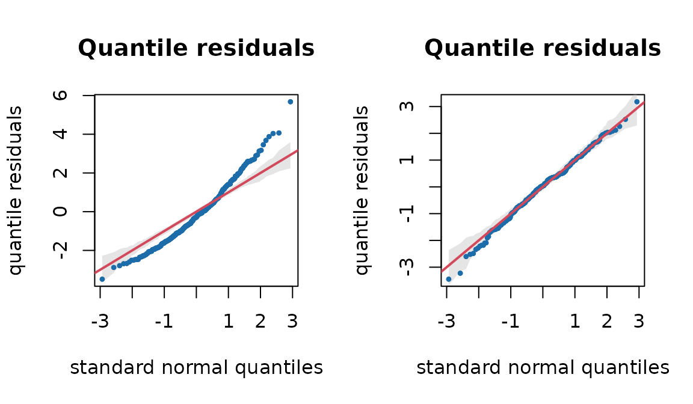
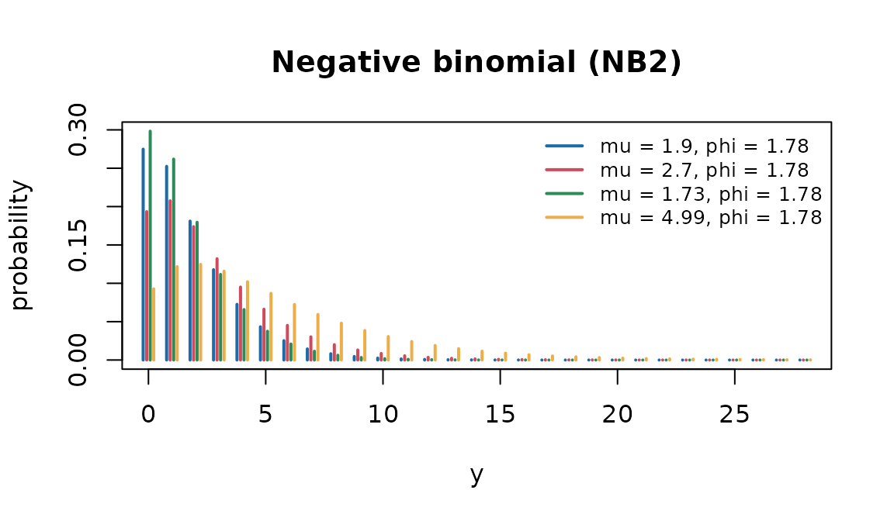
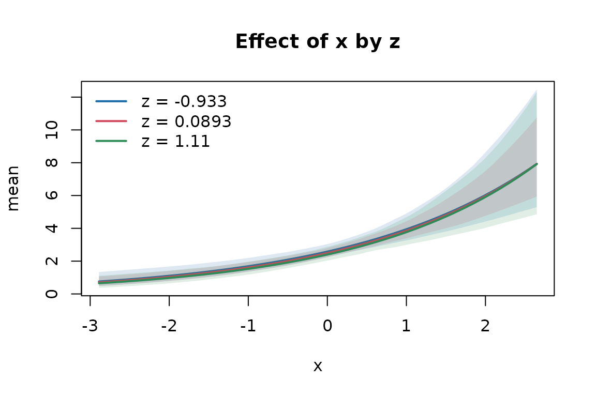

# Model checking and comparison

``` r

library(regcompR)
n <- 300
d <- data.frame(x = rnorm(n), g = factor(rep(1:30, each = 10)))
d$y <- rnbinom(n, mu = exp(1 + 0.5 * d$x), size = 2)
fp <- regcomp(y ~ x, family = "poisson", data = d)
fnb <- regcomp(y ~ x, family = "nb2", data = d)
```

## Residuals

Randomized quantile residuals (Dunn and Smyth 1996) are standard normal
under a correct model for discrete and continuous responses alike. PIT
values are uniform; for discrete laws and laws with point masses they
are randomized within the jump of the CDF.
[`residuals()`](https://rdrr.io/r/stats/residuals.html) also gives
response and Pearson residuals.

``` r

head(cbind(quantile = residuals(fnb), pit = residuals(fnb, type = "pit"),
           response = residuals(fnb, type = "response"), pearson = residuals(fnb, type = "pearson")))
#>      quantile       pit   response    pearson
#> 1 -0.57732203 0.3877221 -0.8974549 -0.4533010
#> 2  1.65680979 0.9513919  5.3003685  2.0336214
#> 3 -1.85657842 0.1451101 -1.7323318 -0.9370229
#> 4  1.38421884 0.9247055  7.0094671  1.6089541
#> 5  0.05618378 0.4245427 -0.8765856 -0.3195656
#> 6  0.29594672 0.6748465  0.2561994  0.1378976
```

## Diagnostic plots

[`plot()`](https://rdrr.io/r/graphics/plot.default.html) of a fit draws
`"qq"` (with a simulation envelope), `"pit"`, `"residuals"` against
fitted values, `"fitted"` against observed, `"rootogram"` for counts,
`"effects"` of a covariate on a parameter, `"ranef"` for random effects,
and for Bayesian fits `"ppc"` (posterior predictive check) and `"trace"`
(one line per chain).

``` r

op <- par(mfrow = c(1, 2))
plot(fp, which = "qq"); plot(fnb, which = "qq")
```



``` r

par(op)
plot(fnb, which = "pit")
```


``` r

plot(fnb, which = "residuals")
```


``` r

plot(fnb, which = "fitted")
```



``` r

plot(fnb, which = "rootogram")
```


``` r

plot(fnb, which = "effects", variable = "x")
```


## Scoring rules

[`scoring_rule()`](https://adamrsophie.github.io/regcompR/reference/scoring_rule.md)
gives one score per observation (smaller is better): the log score
(`"log"`), the continuous ranked probability score (`"crps"`), the
Dawid-Sebastiani score (`"dss"`), and for categorical, ordinal,
Bernoulli and binomial responses the Brier (`"brier"`) and ranked
probability (`"rps"`) scores.

``` r

sapply(c("log", "crps", "dss"), function(r) c(poisson = mean(scoring_rule(fp, rule = r)),
                                              nb2 = mean(scoring_rule(fnb, rule = r))))
#>             log     crps      dss
#> poisson 2.34715 1.410868 3.417775
#> nb2     2.08841 1.351101 2.837920
db <- data.frame(x = rnorm(100)); db$y <- rbinom(100, 1, plogis(db$x))
mean(scoring_rule(regcomp(y ~ x, family = "bernoulli", data = db), rule = "brier"))
#> [1] 0.1854706
```

`re = "conditional"` scores with the estimated group effects,
`re = "zero"` with the effects set to zero, and `re = "marginal"` with
the predictive law of a new group (the mixture over draws of its random
effects, the proper score for an unseen group). For Bayesian fits every
rule scores the posterior predictive distribution (the mixture over
posterior draws), not the law at the posterior mean. The CRPS is
infinite for a predictive law without a finite mean:

``` r

fpar <- regcomp(y ~ 1, xm = 1, family = "pareto", data = data.frame(y = exp(2:6)))
scoring_rule(fpar, data.frame(y = 1), rule = "crps")
#> [1] Inf
```

## Cross validation

[`cv_regcomp()`](https://adamrsophie.github.io/regcompR/reference/cv_regcomp.md)
refits on training folds and scores held out rows. Folds split the
analysis rows of the fit (rows dropped for missing values stay out, and
external weights and trial counts follow their rows). `group =` holds
out whole groups, scored by default as new groups with the marginal
predictive law (`re =` changes this), and its standard error is
clustered by group; `folds =` gives an explicit assignment.

``` r

cv <- cv_regcomp(fnb, K = 5, rule = "log")
c(estimate = cv$estimate, se = cv$se)
#>   estimate         se 
#> 2.09403405 0.05254169
cvg <- cv_regcomp(fnb, rule = "crps", group = "g", K = 5)
cvg$estimate
#> [1] 1.364366
cvf <- cv_regcomp(fnb, folds = rep(1:3, length.out = n))
cvf$estimate
#> [1] 2.102685
```

## Comparing models

[`compare_models()`](https://adamrsophie.github.io/regcompR/reference/compare_models.md)
gives log likelihood, AIC and BIC (and optionally cross validated
scores) for fits to the same observations of the same response; it
refuses fits to different rows, different response transformations, or
Bayesian fits.

``` r

compare_models(poisson = fp, nb2 = fnb, cv = "crps", K = 5)
#>     model                family    logLik df      AIC      BIC  cv_crps
#> 1     nb2 negative_binomial_nb2 -626.5230  3 1259.046 1270.157 1.357629
#> 2 poisson               poisson -704.1451  2 1412.290 1419.698 1.418423
try(compare_models(fp, regcomp(log1p(y) ~ x, family = "normal", data = d)))
#> Error in compare_models(fp, regcomp(log1p(y) ~ x, family = "normal", data = d)) : 
#>   compare_models() needs fits to the same observations of the same response (same rows, same transformation).
```

## Marginal effects, marginal means and R squared

[`avg_effects()`](https://adamrsophie.github.io/regcompR/reference/avg_effects.md)
gives average marginal effects of numeric covariates and average
contrasts between the levels of factors on the scale of the predicted
mean (or of any parameter or linear predictor), with delta method
standard errors (posterior summaries for Bayesian fits); they equal the
`avg_slopes()` and `avg_comparisons()` of marginaleffects.
[`marginal_means()`](https://adamrsophie.github.io/regcompR/reference/marginal_means.md)
averages predictions with every row set to each value of a covariate.
[`r2()`](https://adamrsophie.github.io/regcompR/reference/r2.md) gives
McFadden, Cox and Snell, Nagelkerke and (for normal, binary, binomial,
Poisson and NB2 models) the marginal and conditional R squared of
Nakagawa and Schielzeth;
[`icc()`](https://adamrsophie.github.io/regcompR/reference/r2.md) the
intraclass correlations.

``` r

d$grp <- factor(sample(c("a", "b", "c"), n, TRUE))
fe <- regcomp(y ~ x + grp + (1 | g), family = "nb2", data = d)
avg_effects(fe)
#>   term contrast  estimate std_error statistic      p_value      lower    upper
#> 1    x    dY/dX 1.2098679 0.1950798  6.201912 5.578116e-10 0.82751852 1.592217
#> 2  grp    b - a 0.9147995 0.3707427  2.467478 1.360685e-02 0.18815718 1.641442
#> 3  grp    c - a 0.7409931 0.3584592  2.067162 3.871891e-02 0.03842604 1.443560
marginal_means(fe, "grp")
#>   grp estimate std_error statistic      p_value    lower    upper
#> 1   a 2.191969 0.2313372  9.475210 2.662251e-21 1.738556 2.645382
#> 2   b 3.106768 0.3151544  9.857926 6.334413e-23 2.489077 3.724460
#> 3   c 2.932962 0.2972091  9.868346 5.709826e-23 2.350443 3.515481
r2(fe)
#>    mcfadden   cox_snell  nagelkerke    marginal conditional 
#>  0.04498657  0.17757410  0.17990618  0.24514885  0.27529060
icc(fe)
#>    adjusted conditional 
#>  0.03993071  0.03014174
```

## Tests, simple slopes and collinearity

[`anova()`](https://rdrr.io/r/stats/anova.html) gives likelihood ratio
tests of nested fits;
[`wald_test()`](https://adamrsophie.github.io/regcompR/reference/wald_test.md)
tests linear hypotheses such as equal coefficients (with any covariance
choice);
[`simple_slopes()`](https://adamrsophie.github.io/regcompR/reference/simple_slopes.md)
gives the slope of a covariate on a parameter’s linear predictor at
values of a moderator, with delta method standard errors;
[`vif()`](https://adamrsophie.github.io/regcompR/reference/vif.md) gives
generalized variance inflation factors for each parameter’s regression.

``` r

d$z <- rnorm(n)
fi <- regcomp(y ~ x * z, family = "nb2", data = d)
anova(fnb, fi)
#> Likelihood ratio tests
#> 
#>     df  logLik    AIC  Chisq Chi Df Pr(>Chisq)
#> fnb  3 -626.52 1259.0                         
#> fi   5 -626.31 1262.6 0.4318      2     0.8058
wald_test(fi, c("mu:x" = 1, "mu:z" = -1))
#>   estimate    chisq df      p_value
#> 1   0.4718 32.80417  1 1.019257e-08
wald_test(fi, c("mu:z", "mu:x:z"), vcov = "sandwich")
#>            estimate     chisq df   p_value
#> 1 -0.03592, 0.01325 0.4420737  2 0.8016871
simple_slopes(fi, "x", "z")
#>             z     slope  std_error statistic      p_value
#> 1 -0.93315143 0.4235550 0.08272297  5.120161 3.052743e-07
#> 2  0.08929015 0.4371033 0.05980144  7.309244 2.686499e-13
#> 3  1.11173173 0.4506516 0.08813699  5.113082 3.169450e-07
vif(fi)
#>   parameter term df     gvif gvif_adj
#> 1        mu    x  1 1.001544 1.000771
#> 2        mu    z  1 1.037092 1.018377
#> 3        mu  x:z  1 1.037183 1.018422
```

[`johnson_neyman()`](https://adamrsophie.github.io/regcompR/reference/johnson_neyman.md)
finds the moderator values where the slope of `x` is significant, and
`plot(which = "effects", by =)` draws the interaction:

``` r

johnson_neyman(fi, "x", "z", plot = TRUE)$bounds
```


    #> numeric(0)
    plot(fi, which = "effects", variable = "x", by = "z")



[`step_regcomp()`](https://adamrsophie.github.io/regcompR/reference/step_regcomp.md)
selects terms of one parameter’s formula forward, backward or both ways
by AIC or BIC. Selection makes the final standard errors too optimistic;
prefer penalties or cross validation for prediction.

``` r

d$x2 <- rnorm(n); d$x3 <- rnorm(n)
fs <- step_regcomp(regcomp(y ~ 1, family = "nb2", data = d), scope = ~ x + x2 + x3, criterion = "BIC")
attr(fs, "steps")
#>      step      BIC
#> 1   start 1315.109
#> + x   + x 1270.157
```

## Identifiability, covariances and influence of the data

``` r

identifiability_check(fnb)
#> $condition_number
#> [1] 8.593194
#> 
#> $weak_directions
#> list()
#> 
#> $boundary_variances
#> NULL
#> 
#> $notes
#> character(0)
sqrt(diag(vcov(fp)))
#> lambda:(Intercept)           lambda:x 
#>         0.03820117         0.03599492
sqrt(diag(vcov(fp, type = "sandwich")))
#> lambda:(Intercept)           lambda:x 
#>         0.05912529         0.05575825
sqrt(diag(vcov(fp, type = "sandwich", cluster = ~ g)))
#> lambda:(Intercept)           lambda:x 
#>         0.06868048         0.06863328
```

`type = "quasi"` scales the model covariance by the Pearson dispersion,
which for binomial and Poisson fits gives the standard errors of
`glm(family = quasibinomial)` and `quasipoisson`;
[`summary()`](https://rdrr.io/r/base/summary.html), `tidy()` and
[`regcomp_table()`](https://adamrsophie.github.io/regcompR/reference/regcomp_table.md)
take the same choice through `vcov =`.

``` r

sqrt(diag(vcov(fp, type = "quasi")))
#> lambda:(Intercept)           lambda:x 
#>         0.06049447         0.05700070
summary(fp, vcov = "quasi")$table[, c("estimate", "std_error")]
#>                     estimate  std_error
#> lambda:(Intercept) 0.9120170 0.06049447
#> lambda:x           0.4395698 0.05700070
```

## Simulation based checks

[`simulate()`](https://rdrr.io/r/stats/simulate.html) draws replicated
responses from the fitted model and
[`log_lik()`](https://adamrsophie.github.io/regcompR/reference/log_lik.md)
returns pointwise log likelihoods (one per observation, or a draws by
observations matrix for Bayesian fits, as needed for LOO).

``` r

sims <- simulate(fnb, nsim = 200, seed = 1)
c(observed_zeros = mean(d$y == 0), simulated_zeros = mean(sims == 0))
#>  observed_zeros simulated_zeros 
#>       0.2333333       0.2180000
length(log_lik(fnb))
#> [1] 300
```

## Instrumental variables, panel fixed effects and the Hausman test

[`iv_regcomp()`](https://adamrsophie.github.io/regcompR/reference/iv_regcomp.md)
fits two stage least squares from an ivreg style formula
(`y ~ regressors | instruments`) and reports the weak instrument,
Wu-Hausman and Sargan tests; the results equal `ivreg()`.
[`panel_within()`](https://adamrsophie.github.io/regcompR/reference/panel_within.md)
is the fixed effects (within) estimator of `plm()`, and
[`hausman_test()`](https://adamrsophie.github.io/regcompR/reference/hausman_test.md)
compares it with a random effects fit.

``` r

set.seed(2)
n <- 400; z1 <- rnorm(n); z2 <- rnorm(n); u <- rnorm(n)
xe <- z1 + 0.5 * z2 + u + rnorm(n)
iv_regcomp(y ~ xe | z1 + z2, data = data.frame(y = 1 + 2 * xe + u, xe, z1, z2))
#> <regcomp_lm> instrumental variables (2SLS), n = 400, residual df = 398
#>             estimate std_error       t p_value
#> (Intercept)   1.0167    0.0492 20.6612       0
#> xe            2.0122    0.0402 50.0423       0
#> 
#> Diagnostic tests:
#>                       df1 df2 statistic p_value
#> Weak instruments (xe)   2 397  156.9332  0.0000
#> Wu-Hausman              1 397  166.6047  0.0000
#> Sargan                  1  NA    0.0604  0.8059
pd <- data.frame(id = factor(rep(1:60, each = 5)), x = rnorm(300))
pd$y <- 1 + 0.5 * pd$x + rnorm(60)[pd$id] + rnorm(300)
fe <- panel_within(y ~ x, data = pd, id = "id")
re <- regcomp(y ~ x + (1 | id), family = "normal", data = pd)
hausman_test(fe, re)
#>   statistic df   p_value
#> 1 0.5527477  1 0.4571972
```

## Robust covariances, bootstrap, power and non nested tests

`vcov(type = "HC0")` to `"HC3"` give the heteroscedasticity consistent
covariances of
[`sandwich::vcovHC()`](https://zeileis.codeberg.page/sandwich/reference/vcovHC.html).
[`boot_regcomp()`](https://adamrsophie.github.io/regcompR/reference/boot_regcomp.md)
bootstraps any statistic (parametric or case resampling, by clusters if
needed);
[`power_sim()`](https://adamrsophie.github.io/regcompR/reference/power_sim.md)
estimates the power to detect an effect by simulating from the fit with
chosen coefficients;
[`vuong_test()`](https://adamrsophie.github.io/regcompR/reference/vuong_test.md)
compares non nested models;
[`best_subset()`](https://adamrsophie.github.io/regcompR/reference/best_subset.md)
and
[`step_regcomp()`](https://adamrsophie.github.io/regcompR/reference/step_regcomp.md)
select terms by AIC, AICc, BIC or Hannan-Quinn.

``` r

pw <- data.frame(x1 = rnorm(80), x2 = rnorm(80)); pw$y <- rpois(80, exp(0.5 + 0.3 * pw$x1))
fp <- regcomp(y ~ x1 + x2, family = "poisson", data = pw)
sqrt(diag(vcov(fp, type = "HC3")))
#> lambda:(Intercept)          lambda:x1          lambda:x2 
#>         0.09980880         0.09288988         0.09954112
boot_regcomp(fp, R = 50)
#> <regcomp_boot> parametric bootstrap, 50 replicates
#>                    estimate std_error   lower  upper
#> lambda:(Intercept)   0.5376    0.0807  0.3157 0.6311
#> lambda:x1            0.1087    0.0885 -0.0399 0.2922
#> lambda:x2           -0.1197    0.0740 -0.2559 0.0187
power_sim(fp, "lambda:x1", nsim = 50, coefficients = c("lambda:x1" = 0.2))
#>        term power     lower     upper nsim failed
#> 1 lambda:x1  0.74 0.5965523 0.8536994   50      0
vuong_test(fp, regcomp(y ~ x1 + x2, family = "negative_binomial_nb2", data = pw))
#>                statistic   p_value preferred
#> Raw           -0.6649517 0.2530407   model 2
#> AIC-corrected  0.1636208 0.4350148   model 1
#> BIC-corrected  1.1504617 0.1249769   model 1
best_subset(fp, criterion = "AICc")
#>     terms     AICc df
#> 1  (none) 280.8812  1
#> 2      x2 280.9031  2
#> 3      x1 281.0836  2
#> 4 x1 + x2 281.2575  3
```

## Uplift models and higher order inference

[`uplift()`](https://adamrsophie.github.io/regcompR/reference/uplift.md)
gives individual treatment effects of a model with treatment by
covariate interactions and
[`qini()`](https://adamrsophie.github.io/regcompR/reference/qini.md)
evaluates them (the Qini curve and coefficient, as tools4uplift).
[`skovgaard_test()`](https://adamrsophie.github.io/regcompR/reference/skovgaard_test.md)
refines the likelihood ratio test of one coefficient for small samples.

``` r

up <- data.frame(t = rbinom(400, 1, 0.5), x = rnorm(400))
up$y <- rbinom(400, 1, plogis(-0.5 + 0.3 * up$x + up$t * (0.2 + 0.8 * up$x)))
fu <- regcomp(y ~ t * x, family = "bernoulli", data = up)
attr(qini(uplift(fu, "t"), up$t, up$y), "qini")
#> [1] 5.164355
sm <- data.frame(x = rnorm(15)); sm$y <- rpois(15, exp(0.5 + 0.4 * sm$x))
skovgaard_test(regcomp(y ~ x, family = "poisson", data = sm), "lambda:x", R = 500)
#>      statistic     p_value
#> Wald  2.559985 0.010467655
#> r     2.742970 0.006088617
#> r*    2.717801 0.006571741
```
