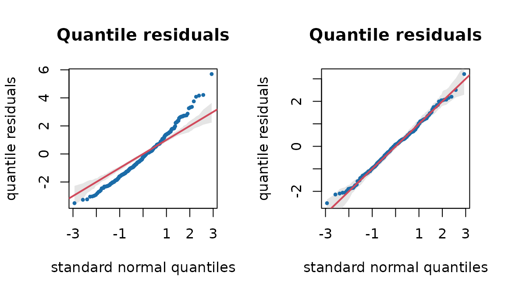
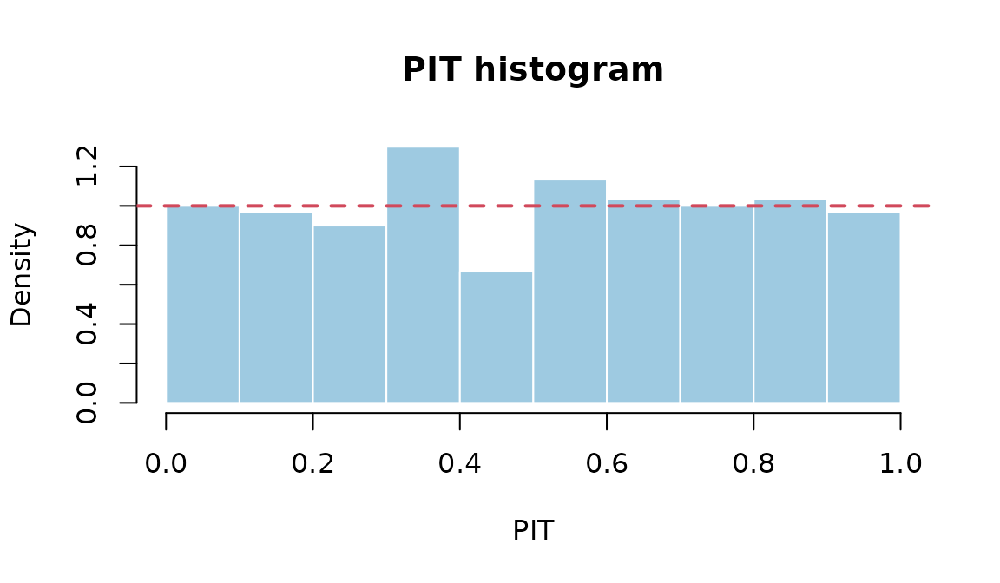

# Model checking and comparison

``` r

library(regcompR)
n <- 300
d <- data.frame(x = rnorm(n))
d$y <- rnbinom(n, mu = exp(1 + 0.5 * d$x), size = 2)
fp <- regcomp(y ~ x, family = "poisson", data = d)
fnb <- regcomp(y ~ x, family = "nb2", data = d)
```

## Residuals

Randomized quantile residuals (Dunn and Smyth 1996) are standard normal
under a correct model for discrete and continuous responses alike.

``` r

op <- par(mfrow = c(1, 2))
plot(fp, which = "qq"); plot(fnb, which = "qq")
```



``` r

par(op)
plot(fnb, which = "pit")
```



## Scoring rules and cross validation

[`scoring_rule()`](https://adamrsophie.github.io/regcompR/reference/scoring_rule.md)
gives the pointwise log score, CRPS, Dawid Sebastiani, Brier or ranked
probability score;
[`cv_regcomp()`](https://adamrsophie.github.io/regcompR/reference/cv_regcomp.md)
gives K fold cross validated scores (with grouped folds for clustered
data).

``` r

c(poisson = mean(scoring_rule(fp, rule = "crps")), nb2 = mean(scoring_rule(fnb, rule = "crps")))
#>  poisson      nb2 
#> 1.410868 1.351101
cv <- cv_regcomp(fnb, K = 5, rule = "log")
c(estimate = cv$estimate, se = cv$se)
#>   estimate         se 
#> 2.09403405 0.05254169
compare_models(poisson = fp, nb2 = fnb)
#>     model                family    logLik df      AIC      BIC
#> 1     nb2 negative_binomial_nb2 -626.5230  3 1259.046 1270.157
#> 2 poisson               poisson -704.1451  2 1412.290 1419.698
```

## Identifiability and robust standard errors

``` r

identifiability_check(fnb)
#> $condition_number
#> [1] 8.593197
#> 
#> $weak_directions
#> list()
#> 
#> $boundary_variances
#> NULL
#> 
#> $notes
#> character(0)
sqrt(diag(vcov(fp, type = "sandwich")))
#> lambda:(Intercept)           lambda:x 
#>         0.05912529         0.05575825
```

## Posterior predictive checks

For Bayesian fits, `plot(fit, which = "ppc")` compares the observed
distribution with replicated data and `plot(fit, which = "trace")` shows
the chains.
