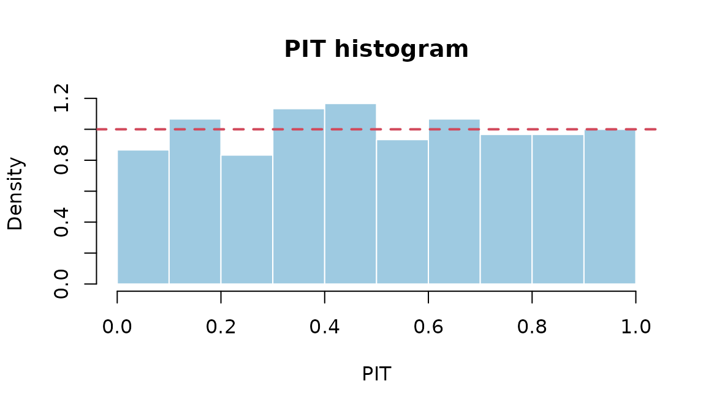
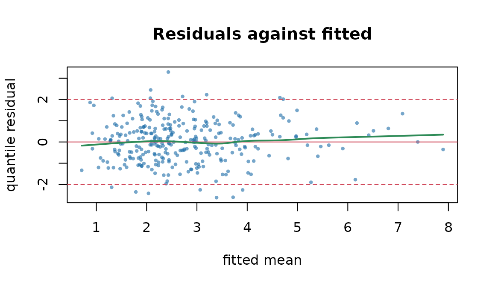
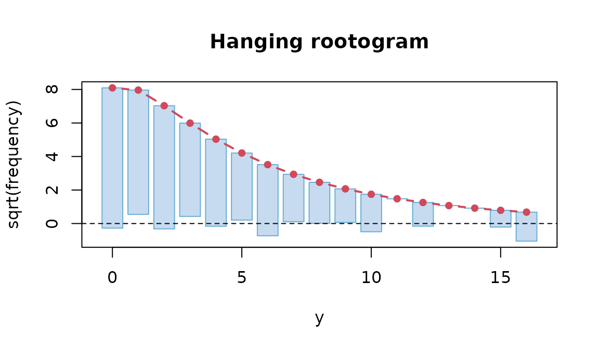

# Model checking and comparison

``` r

library(regcompR)
n <- 300
d <- data.frame(x = rnorm(n), g = factor(rep(1:30, each = 10)))
d$y <- rnbinom(n, mu = exp(1 + 0.5 * d$x), size = 2)
fp <- regcomp(y ~ x, family = "poisson", data = d)
fnb <- regcomp(y ~ x, family = "nb2", data = d)
```

## Residuals

Randomized quantile residuals (Dunn and Smyth 1996) are standard normal
under a correct model for discrete and continuous responses alike. PIT
values are uniform; for discrete laws and laws with point masses they
are randomized within the jump of the CDF.
[`residuals()`](https://rdrr.io/r/stats/residuals.html) also gives
response and Pearson residuals.

``` r

head(cbind(quantile = residuals(fnb), pit = residuals(fnb, type = "pit"),
           response = residuals(fnb, type = "response"), pearson = residuals(fnb, type = "pearson")))
#>      quantile       pit   response    pearson
#> 1 -0.57732203 0.3877221 -0.8974549 -0.4533010
#> 2  1.65680979 0.9513919  5.3003685  2.0336214
#> 3 -1.85657842 0.1451101 -1.7323318 -0.9370229
#> 4  1.38421884 0.9247055  7.0094671  1.6089541
#> 5  0.05618378 0.4245427 -0.8765856 -0.3195656
#> 6  0.29594672 0.6748465  0.2561994  0.1378976
```

## Diagnostic plots

[`plot()`](https://rdrr.io/r/graphics/plot.default.html) of a fit draws
`"qq"` (with a simulation envelope), `"pit"`, `"residuals"` against
fitted values, `"fitted"` against observed, `"rootogram"` for counts,
`"effects"` of a covariate on a parameter, `"ranef"` for random effects,
and for Bayesian fits `"ppc"` (posterior predictive check) and `"trace"`
(one line per chain).

``` r

op <- par(mfrow = c(1, 2))
plot(fp, which = "qq"); plot(fnb, which = "qq")
```


``` r

par(op)
plot(fnb, which = "pit")
```



``` r

plot(fnb, which = "residuals")
```



``` r

plot(fnb, which = "fitted")
```


``` r

plot(fnb, which = "rootogram")
```



``` r

plot(fnb, which = "effects", variable = "x")
```


## Scoring rules

[`scoring_rule()`](https://adamrsophie.github.io/regcompR/reference/scoring_rule.md)
gives one score per observation (smaller is better): the log score
(`"log"`), the continuous ranked probability score (`"crps"`), the
Dawid-Sebastiani score (`"dss"`), and for categorical, ordinal,
Bernoulli and binomial responses the Brier (`"brier"`) and ranked
probability (`"rps"`) scores.

``` r

sapply(c("log", "crps", "dss"), function(r) c(poisson = mean(scoring_rule(fp, rule = r)),
                                              nb2 = mean(scoring_rule(fnb, rule = r))))
#>             log     crps      dss
#> poisson 2.34715 1.410868 3.417775
#> nb2     2.08841 1.351101 2.837920
db <- data.frame(x = rnorm(100)); db$y <- rbinom(100, 1, plogis(db$x))
mean(scoring_rule(regcomp(y ~ x, family = "bernoulli", data = db), rule = "brier"))
#> [1] 0.1854706
```

`re = "conditional"` scores with the estimated group effects and
`re = "zero"` as for new groups. For Bayesian fits every rule scores the
posterior predictive distribution (the mixture over posterior draws),
not the law at the posterior mean. The CRPS is infinite for a predictive
law without a finite mean:

``` r

fpar <- regcomp(y ~ 1, xm = 1, family = "pareto", data = data.frame(y = exp(2:6)))
scoring_rule(fpar, data.frame(y = 1), rule = "crps")
#> [1] Inf
```

## Cross validation

[`cv_regcomp()`](https://adamrsophie.github.io/regcompR/reference/cv_regcomp.md)
refits on training folds and scores held out rows. Folds split the
analysis rows of the fit (rows dropped for missing values stay out, and
external weights and trial counts follow their rows). `group =` holds
out whole groups, predicted with their random effects at zero; `folds =`
gives an explicit assignment.

``` r

cv <- cv_regcomp(fnb, K = 5, rule = "log")
c(estimate = cv$estimate, se = cv$se)
#>   estimate         se 
#> 2.09403405 0.05254169
cvg <- cv_regcomp(fnb, rule = "crps", group = "g", K = 5)
cvg$estimate
#> [1] 1.364366
cvf <- cv_regcomp(fnb, folds = rep(1:3, length.out = n))
cvf$estimate
#> [1] 2.102685
```

## Comparing models

[`compare_models()`](https://adamrsophie.github.io/regcompR/reference/compare_models.md)
gives log likelihood, AIC and BIC (and optionally cross validated
scores) for fits to the same observations of the same response; it
refuses fits to different rows, different response transformations, or
Bayesian fits.

``` r

compare_models(poisson = fp, nb2 = fnb, cv = "crps", K = 5)
#>     model                family    logLik df      AIC      BIC  cv_crps
#> 1     nb2 negative_binomial_nb2 -626.5230  3 1259.046 1270.157 1.357629
#> 2 poisson               poisson -704.1451  2 1412.290 1419.698 1.418423
try(compare_models(fp, regcomp(log1p(y) ~ x, family = "normal", data = d)))
#> Error in compare_models(fp, regcomp(log1p(y) ~ x, family = "normal", data = d)) : 
#>   compare_models() needs fits to the same observations of the same response (same rows, same transformation).
```

## Identifiability, covariances and influence of the data

``` r

identifiability_check(fnb)
#> $condition_number
#> [1] 8.593194
#> 
#> $weak_directions
#> list()
#> 
#> $boundary_variances
#> NULL
#> 
#> $notes
#> character(0)
sqrt(diag(vcov(fp)))
#> lambda:(Intercept)           lambda:x 
#>         0.03820117         0.03599492
sqrt(diag(vcov(fp, type = "sandwich")))
#> lambda:(Intercept)           lambda:x 
#>         0.05912529         0.05575825
sqrt(diag(vcov(fp, type = "sandwich", cluster = ~ g)))
#> lambda:(Intercept)           lambda:x 
#>         0.06868048         0.06863328
```

## Simulation based checks

[`simulate()`](https://rdrr.io/r/stats/simulate.html) draws replicated
responses from the fitted model and
[`log_lik()`](https://adamrsophie.github.io/regcompR/reference/log_lik.md)
returns pointwise log likelihoods (one per observation, or a draws by
observations matrix for Bayesian fits, as needed for LOO).

``` r

sims <- simulate(fnb, nsim = 200, seed = 1)
c(observed_zeros = mean(d$y == 0), simulated_zeros = mean(sims == 0))
#>  observed_zeros simulated_zeros 
#>       0.2333333       0.2180000
length(log_lik(fnb))
#> [1] 300
```
