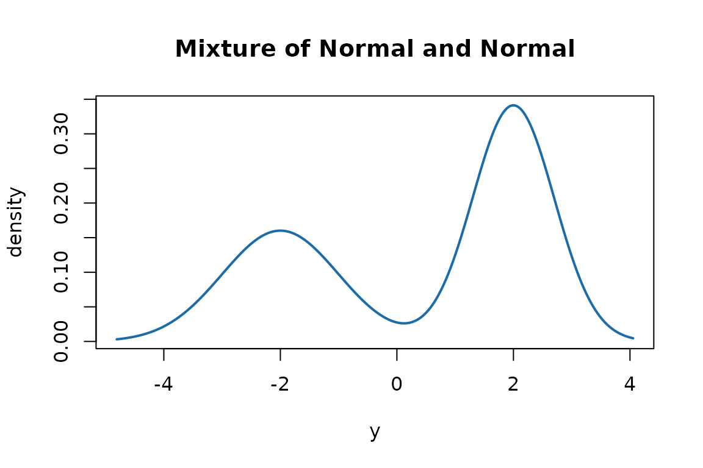
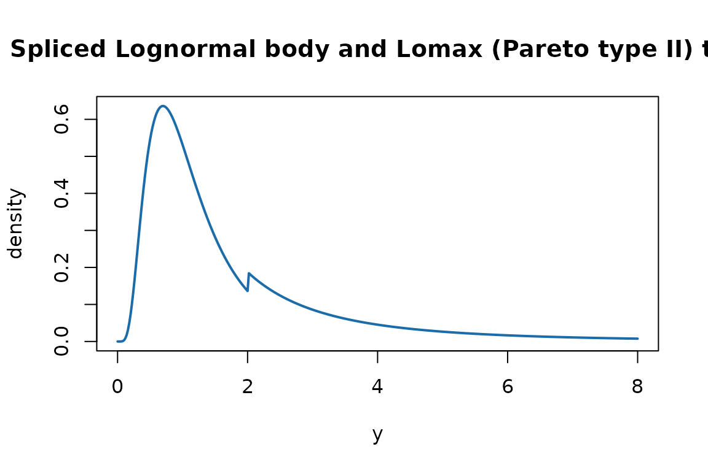

# Building new distributions with operators

``` r

library(regcompR)
```

An operator takes one or more families and returns a new family. The
result is an ordinary family: it works in
[`distribution()`](https://adamrsophie.github.io/regcompR/reference/distribution.md),
in
[`regcomp()`](https://adamrsophie.github.io/regcompR/reference/regcomp.md)
(every parameter can take a formula) and, when its parts have Stan code,
in the Bayesian engine. Parameters of a single base keep their names;
parameters of several components get a suffix (`mu.1`, `mu.2`, or `.b`
and `.t` for the body and tail of a spliced law).

## Point masses and lattices

Every family states how it carries probability. A discrete law lives on
a lattice (the integers for counts, multiples of 0.1 for a law rounded
to one decimal); a continuous law has a density and may also have point
masses (atoms), as a zero inflated gamma has at zero. Operators use this
contract: they add atoms where they should, keep the lattice of their
base, refuse inflation points off the lattice, and refuse combinations
that have no well defined density.

### Inflation and hurdles

[`inflate()`](https://adamrsophie.github.io/regcompR/reference/inflate.md)
adds point masses at one or several values. For a count base the
inflated value keeps its base probability as well; for a continuous base
it becomes an atom.

``` r

zip <- inflate("poisson")
d <- distribution(zip, lambda = 2, zi = 0.3)
prob(d, 0:3)
#> [1] 0.3947347 0.1894694 0.1894694 0.1263129
mean(d)
#> [1] 1.4
zoib <- inflate("beta", at = c(0, 1))            # zero and one inflated beta
names(zoib$pars)
#> [1] "mu"  "phi" "pi1" "pi2"
db <- distribution(zoib, mu = 0.4, phi = 5, pi1 = 0.1, pi2 = 0.05)
prob(db, c(0, 1))                                  # the two atoms
#> [1] 0.10 0.05
try(inflate("poisson", at = 0.5))                  # not on the integer lattice
#> Error in inflate("poisson", at = 0.5) : 
#>   Inflation points of a discrete law must lie on its lattice (integers for counts).
```

[`hurdle()`](https://adamrsophie.github.io/regcompR/reference/hurdle.md)
replaces the probability at the hurdle value: the base law is truncated
away from it and the hurdle probability is a parameter.

``` r

hnb <- hurdle("nb2")
prob(distribution(hnb, mu = 3, phi = 1, hu = 0.1), 0:3)
#> [1] 0.1000000 0.2250000 0.1687500 0.1265625
zag <- hurdle("gamma")                             # zero adjusted gamma
pz <- distribution(zag, mu = 2, sigma = 0.5, hu = 0.2)
c(prob(pz, 0), cdf(pz, 0), mean(pz))
#> [1] 0.2 0.2 1.6
```

### Truncation, censoring, discretizing and rounding

``` r

ztp <- truncate_dist("poisson", lower = 1)         # zero truncated Poisson
prob(distribution(ztp, lambda = 1.5), 0:3)
#> [1] 0.0000000 0.4308254 0.3231190 0.1615595
tobit <- censor("normal", lower = 0)               # atom at the censoring point
prob(distribution(tobit, mu = 0.5, sigma = 1), c(0, 1))
#> [1] 0.3085375 0.3520653
dg <- discretize("gamma")                          # P(Y = k) = F(k + 1) - F(k)
sum(prob(distribution(dg, mu = 3, sigma = 0.5), 0:200))
#> [1] 1
r1 <- round_dist("normal", digits = 1)             # lattice of multiples of 0.1
prob(distribution(r1, mu = 0, sigma = 0.2), c(0, 0.1, 0.05))
#> [1] 0.1974127 0.1746663 0.0000000
```

A discretized or rounded law keeps the mass of its tails, so the masses
sum to one even for far tails.

### Finite mixtures

[`mixture()`](https://adamrsophie.github.io/regcompR/reference/mixture.md)
takes two or more components. The weights of components 2 to K are on
the multinomial logit scale relative to the first component.

``` r

mx <- mixture("normal", "normal")
d <- distribution(mx, mu.1 = -2, sigma.1 = 1, mu.2 = 2, sigma.2 = 0.7, w2 = 0.4)
plot(d)
```



``` r

m3 <- mixture("poisson", "poisson", "poisson")
names(m3$pars)
#> [1] "lambda.1" "lambda.2" "lambda.3" "w2"       "w3"
```

Components must share a lattice; a mixture of a count law and a law with
atoms keeps the atoms.

### Convolutions, splicing and copulas

[`convolve_dist()`](https://adamrsophie.github.io/regcompR/reference/convolve_dist.md)
gives the law of a sum of two independent variables. When one of them
has point masses at known places (a zero inflated or hurdle law) the
density of the sum is the continuous part plus the shifted atoms; when
both have, the sum also has point masses at the sums of their locations.

``` r

emg <- convolve_dist("normal", "exponential")      # exponentially modified Gaussian
prob(distribution(emg, mu.1 = 0, sigma.1 = 1, lambda.2 = 2), c(0, 1, 2))
#> [1] 0.3362040 0.3173105 0.1353353
pp <- convolve_dist("poisson", "poisson")
all.equal(prob(distribution(pp, lambda.1 = 1.5, lambda.2 = 2.2), 0:5), dpois(0:5, 3.7))
#> [1] TRUE
zz <- convolve_dist(inflate("gamma"), censor("normal", lower = 0))
prob(distribution(zz, mu.1 = 2, sigma.1 = 0.5, zi.1 = 0.3, mu.2 = 0.2, sigma.2 = 1), 0)   # 0.3 * P(N < 0)
#> [1] 0.1262221
```

[`splice()`](https://adamrsophie.github.io/regcompR/reference/splice.md)
joins a body law below a threshold with a tail law above it;
[`copula_dist()`](https://adamrsophie.github.io/regcompR/reference/copula_dist.md)
builds a bivariate law from two margins and a Gaussian, Clayton, Gumbel
or Frank copula. Margins may be continuous, discrete, or continuous with
point masses, and need not be of the same type: at a jump of a margin
the copula is differenced across the jump.

``` r

sp <- splice("lognormal", "lomax")
plot(distribution(sp, mu.b = 0, sigma.b = 0.6, scale.t = 2, alpha.t = 2.5,
                  threshold = 2, w = 0.7), xlim = c(0, 8))
```



``` r

cp <- copula_dist("normal", "gamma", "clayton")
names(cp$pars)
#> [1] "mu.1"    "sigma.1" "mu.2"    "sigma.2" "theta"
dc <- distribution(cp, mu.1 = 0, sigma.1 = 1, mu.2 = 2, sigma.2 = 0.5, theta = 2)
log_prob(dc, cbind(0.2, 1.5))
#> [1] -1.639693
hc <- copula_dist("poisson", inflate("gamma"), "frank")       # a count and a zero inflated amount
log_prob(distribution(hc, lambda.1 = 2, mu.2 = 2, sigma.2 = 0.5, zi.2 = 0.3, theta = 3), rbind(c(1, 0), c(1, 2.5)))
#> [1] -2.160720 -3.496421
```

Every other operator also accepts a law with point masses: truncation
keeps the atoms inside `[lower, upper]` and rescales them, censoring
adds the tail mass to the bounds, rounding puts each atom in its bin,
monotone transformations move the atoms, splicing keeps the body atoms
below the threshold and the tail atoms above it, and CDF generators give
an atom at `c` the mass `T(G(c)) - T(G(c-))`.

``` r

zg <- inflate("gamma")
prob(distribution(truncate_dist(zg, 0, 3), mu = 2, sigma = 0.5, zi = 0.3), 0)
#> [1] 0.3355114
prob(distribution(round_dist(zg), mu = 2, sigma = 0.5, zi = 0.3), 0:2)
#> [1] 0.3132917 0.2336460 0.2675442
prob(distribution(exponentiated(zg), mu = 2, sigma = 0.5, zi = 0.3, a = 2), 0)
#> [1] 0.09
```

### Cure models, compounding, weighting and transformations

``` r

cw <- cure("weibull")                              # S(t) = cure + (1 - cure) S0(t)
survival(distribution(cw, shape = 1.5, scale = 2, cure = 0.3), c(1, 10, 100))
#> [1] 0.7915320 0.3000098 0.3000000
nb <- compound("poisson", "lambda", "gamma_rate")  # Poisson mixed over a gamma rate
names(nb$pars)
#> [1] "shape_mix" "rate_mix"
lb <- weighted("birnbaum_saunders")                # length biased law, density y f(y) / E(Y)
cg <- contaminated("gamma", par = "sigma")         # a fraction delta with sigma inflated by eta
names(cg$pars)
#> [1] "mu"    "sigma" "delta" "eta"
ln <- transform_dist("normal", "exp")              # the lognormal law
all.equal(prob(distribution(ln, mu = 0, sigma = 1), 1), dlnorm(1))
#> [1] TRUE
we <- wrap("exponential")                          # wrapped onto the circle
prob(distribution(we, lambda = 0.8), c(-1, 0.5, 2))
#> [1] 0.01175932 0.53979788 0.16258400
qw <- quantile_param("weibull", par = "scale", tau = 0.5)   # regress the median
names(qw$pars)
#> [1] "q"     "shape"
quantile(distribution(qw, q = 3, shape = 2), 0.5)
#> [1] 3
```

[`quantile_param()`](https://adamrsophie.github.io/regcompR/reference/quantile_param.md)
replaces a parameter by a quantile of the law, so a regression on `q` is
a parametric quantile regression.

### Skewing

``` r

sl <- skew_symmetric("logistic", "logistic")
names(sl$pars)
#> [1] "mu"    "sigma" "alpha"
ssvm <- sine_skew("von_mises")                     # sine skewed circular law
names(ssvm$pars)
#> [1] "mu"     "kappa"  "lambda"
```

## Generated families

Generators build the families of the distribution literature from a
baseline `G` through `F(y) = T(G(y))`. New shape parameters are appended
to the baseline parameters and can take formulas.

| Generator | `T(u)` |
|----|----|
| [`exponentiated()`](https://adamrsophie.github.io/regcompR/reference/exponentiated.md) | `u^a` |
| [`kumaraswamy_g()`](https://adamrsophie.github.io/regcompR/reference/exponentiated.md) | `1 - (1 - u^a)^b` |
| [`beta_g()`](https://adamrsophie.github.io/regcompR/reference/exponentiated.md) | regularized incomplete beta `I_u(a, b)` |
| [`mcdonald_g()`](https://adamrsophie.github.io/regcompR/reference/exponentiated.md) | `I_{u^c}(a, b)` |
| [`exp_generalized_g()`](https://adamrsophie.github.io/regcompR/reference/exponentiated.md) | `(1 - (1 - u)^a)^b` |
| [`marshall_olkin()`](https://adamrsophie.github.io/regcompR/reference/exponentiated.md) | `u / (alpha + (1 - alpha) u)` |
| [`transmuted()`](https://adamrsophie.github.io/regcompR/reference/exponentiated.md) | `(1 + lambda) u - lambda u^2` |
| [`record_transmuted()`](https://adamrsophie.github.io/regcompR/reference/exponentiated.md) | `u + p (1 - u) log(1 - u)` |
| [`odd_log_logistic()`](https://adamrsophie.github.io/regcompR/reference/exponentiated.md) | `u^a / (u^a + (1 - u)^a)` |
| [`odd_burr()`](https://adamrsophie.github.io/regcompR/reference/exponentiated.md) | `1 - (1 + (u / (1 - u))^a)^(-b)` |
| [`weibull_g()`](https://adamrsophie.github.io/regcompR/reference/exponentiated.md) | `1 - exp(-a (u / (1 - u))^b)` |
| [`gamma_g()`](https://adamrsophie.github.io/regcompR/reference/exponentiated.md) | Zografos and Balakrishnan, or Ristic and Balakrishnan |
| [`topp_leone_g()`](https://adamrsophie.github.io/regcompR/reference/exponentiated.md) | `(u (2 - u))^a` |
| [`sine_g()`](https://adamrsophie.github.io/regcompR/reference/exponentiated.md) | `sin(pi u / 2)` |
| [`harris_g()`](https://adamrsophie.github.io/regcompR/reference/exponentiated.md), [`lindley_g()`](https://adamrsophie.github.io/regcompR/reference/exponentiated.md) | Harris extended and Lindley generators |
| [`dus()`](https://adamrsophie.github.io/regcompR/reference/exponentiated.md), [`km()`](https://adamrsophie.github.io/regcompR/reference/exponentiated.md) | `(e^u - 1) / (e - 1)` and `e (1 - e^(-u)) / (e - 1)` |
| [`power_series_max()`](https://adamrsophie.github.io/regcompR/reference/exponentiated.md), [`power_series_min()`](https://adamrsophie.github.io/regcompR/reference/exponentiated.md) | maximum or minimum of a power series number of draws |

``` r

kw <- kumaraswamy_g("weibull")
names(kw$pars)
#> [1] "shape" "scale" "a"     "b"
bw <- beta_g("weibull")
cdf(distribution(bw, shape = 1.5, scale = 2, a = 2, b = 0.5), 1)
#> [1] 0.03725503
gens <- list(exponentiated("exponential"), mcdonald_g("exponential"), exp_generalized_g("exponential"),
             marshall_olkin("exponential"), transmuted("exponential"), record_transmuted("exponential"),
             odd_log_logistic("exponential"), odd_burr("exponential"), weibull_g("exponential"),
             gamma_g("exponential"), topp_leone_g("exponential"), sine_g("exponential"),
             harris_g("exponential"), lindley_g("exponential"), dus("exponential"), km("exponential"),
             power_series_max("exponential", "poisson"), power_series_min("exponential", "geometric"))
data.frame(family = vapply(gens, `[[`, "", "display_name"),
           parameters = vapply(gens, function(f) paste(names(f$pars), collapse = ", "), ""))
#>                                             family       parameters
#> 1                        Exponentiated Exponential        lambda, a
#> 2                       McDonald (GB1) Exponential  lambda, a, b, c
#> 3            Exponentiated generalized Exponential     lambda, a, b
#> 4                       Marshall-Olkin Exponential    lambda, alpha
#> 5                           Transmuted Exponential  lambda, lambda_
#> 6              Record-based transmuted Exponential     lambda, prob
#> 7                     Odd log-logistic Exponential        lambda, a
#> 8                         Odd Burr XII Exponential     lambda, a, b
#> 9                              Weibull Exponential     lambda, a, b
#> 10       Gamma (Zografos-Balakrishnan) Exponential        lambda, a
#> 11                          Topp-Leone Exponential        lambda, a
#> 12                                Sine Exponential           lambda
#> 13                     Harris extended Exponential lambda, theta, k
#> 14                             Lindley Exponential    lambda, theta
#> 15                     DUS transformed Exponential           lambda
#> 16         Kavya-Manoharan transformed Exponential           lambda
#> 17   poisson maximum (power series) of Exponential    lambda, theta
#> 18 geometric minimum (power series) of Exponential    lambda, theta
```

A generated family is fitted like any other:

``` r

y <- rweibull(300, shape = 1.5, scale = 2)
fk <- regcomp(y ~ 1, family = marshall_olkin("weibull"), data = data.frame(y = y))
coef(fk)
#> shape:(Intercept) scale:(Intercept) alpha:(Intercept) 
#>         0.4447104         0.5369417         0.4316568
```

## Custom families

[`custom_family()`](https://adamrsophie.github.io/regcompR/reference/custom_family.md)
registers a law from its log density. The total mass is checked
numerically at the parameter values given in `check`; cdf, quantile, rng
and moments are optional and fall back to numerical methods.

``` r

myexp <- custom_family("my_exponential", list(par_spec("rate", "positive", role = "rate")),
  lpdf = function(y, p) dexp(y, p$rate, log = TRUE),
  support = function(p) list(lower = 0, upper = Inf), check = list(rate = 2))
coef(regcomp(y ~ 1, family = myexp, data = data.frame(y = rexp(200, 2))))
#> rate:(Intercept) 
#>        0.7390299
quantile(distribution(myexp, rate = 2), 0.5)
#> [1] 0.3465736
```

## What is refused

Operators refuse combinations whose result is not well defined, instead
of returning a wrong answer:

- convolution, censoring or a monotone transformation of a law whose
  point masses are at unknown places (a custom family with an `atom`
  function but no `atom_points`), since the result’s masses cannot be
  located;
- a mixture of discrete laws on different lattices;
- inflation or hurdle points that are not on the lattice of a discrete
  base.

Stan code is generated for operators whose parts have Stan code; laws
with point masses inside a continuous density (an inflated or hurdle
continuous law, for example) are fitted by the `"ml"` and `"tmb"`
engines only.
[`family_capabilities()`](https://adamrsophie.github.io/regcompR/reference/family_capabilities.md)
reports what is available for a given family.

``` r

family_capabilities(hurdle("poisson"))$stan
#> [1] "generated"
family_capabilities(inflate("gamma"))$stan
#> [1] "generated"
```
