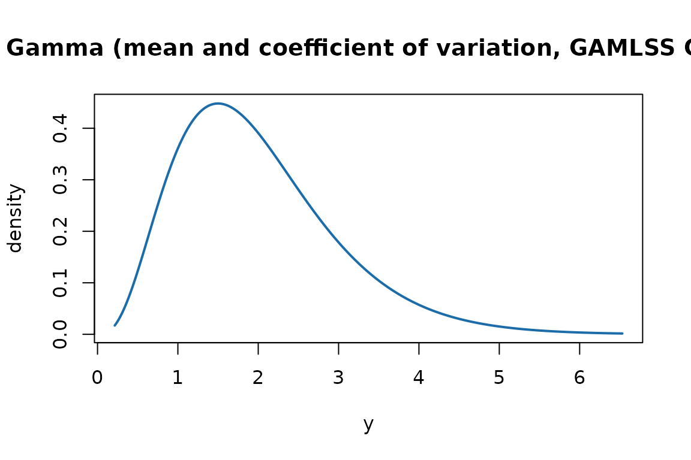
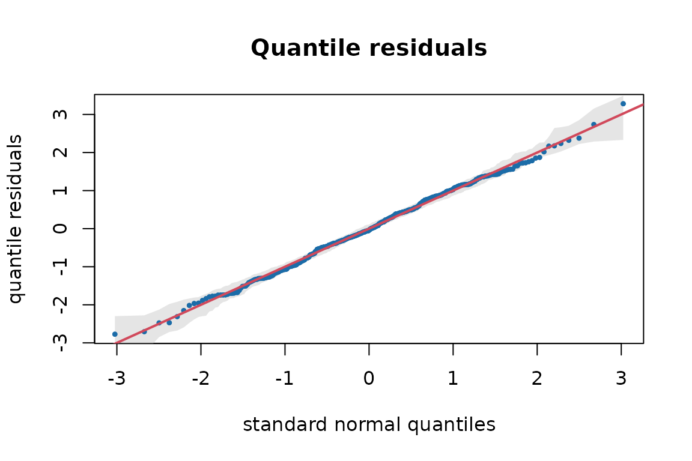

# Getting started with regcompR

regcompR fits distributional regression models: every parameter of a
response distribution can depend on covariates through its own formula.
The same model specification can be fitted by maximum likelihood,
through TMB, or by Bayesian inference in Stan, JAGS or OpenBUGS.

``` r

library(regcompR)
```

## Distributions

Every family lives in a registry that records its support, parameters,
links, moments and references.

``` r

length(families())
#> [1] 278
head(families("count"), 10)
#>  [1] "bell"                        "beta_negative_binomial"     
#>  [3] "borel"                       "borel_tanner"               
#>  [5] "conway_maxwell_poisson"      "conway_maxwell_poisson_mean"
#>  [7] "delaporte"                   "discrete_compound_poisson"  
#>  [9] "discrete_phase_type"         "discrete_weibull"
get_family("nb2")
#> <regcomp_family negative_binomial_nb2> Negative binomial (NB2)
#>   category: count, variate: scalar, discrete, status: validated
#>   parameters:
#>     mu       positive          link log       [mean]
#>     phi      positive          link log       
#>   formula: p(y) = C(y + phi - 1, y) (mu / (mu + phi))^y (phi / (mu + phi))^phi
```

A distribution object evaluates densities, distribution functions,
quantiles, moments and random draws.

``` r

d <- distribution("gamma", mu = 2, sigma = 0.5)
prob(d, c(1, 2, 3))
#> [1] 0.3608941 0.3907336 0.1784702
cdf(d, 2)
#> [1] 0.5665299
quantile(d, c(0.1, 0.5, 0.9))
#> [1] 0.8723848 1.8360304 3.3403915
mean(d); variance(d)
#> [1] 2
#> [1] 1
plot(d)
```



## A first regression

The first formula is the main formula (it models the mean parameter, or
the location or scale parameter where there is no mean). Further
formulas name the parameter on their left side.

``` r

n <- 400
dat <- data.frame(x = runif(n))
dat$y <- rgamma(n, shape = 1 / (0.3 + 0.4 * dat$x)^2,
                scale = exp(1 + dat$x) * (0.3 + 0.4 * dat$x)^2)
fit <- regcomp(y ~ x, sigma ~ x, family = "gamma", data = dat)
summary(fit)
#> <regcomp_fit> Gamma (mean and coefficient of variation, GAMLSS GA) regression, engine 'ml' (frequentist)
#>   mu (log link): ~x
#>   sigma (log link): ~x
#>   log likelihood -847.334 on 4 parameters, n = 400
#> 
#> Wald estimates with 95% confidence intervals:
#>                   estimate std_error   lower   upper        z p_value
#> mu:(Intercept)      1.0185    0.0436  0.9330  1.1040  23.3467       0
#> mu:x                0.9451    0.0930  0.7628  1.1273  10.1644       0
#> sigma:(Intercept)  -1.0365    0.0704 -1.1745 -0.8985 -14.7178       0
#> sigma:x             0.7063    0.1230  0.4652  0.9474   5.7422       0
#> max |gradient| 4.27e-04; Hessian positive definite
```

## Predictions

``` r

nd <- data.frame(x = c(0.1, 0.5, 0.9))
predict(fit, nd, type = "mean")
#>        1        2        3 
#> 3.043440 4.441583 6.482027
predict(fit, nd, type = "quantile", probs = c(0.05, 0.95))
#>         q0.05     q0.95
#> [1,] 1.419094  5.165008
#> [2,] 1.496452  8.654465
#> [3,] 1.311622 14.861855
predict(fit, nd, type = "probability", at = 5)
#>      probability(5)
#> [1,]     0.07538366
#> [2,]     0.15034372
#> [3,]     0.10713322
predict(fit, nd, type = "mean", interval = "confidence")
#>   estimate    lower    upper
#> 1 3.043440 2.830893 3.278969
#> 2 4.441583 4.223428 4.672939
#> 3 6.482027 5.820990 7.171435
```

## Checking the fit

Randomized quantile residuals are standard normal under a correct model.

``` r

plot(fit, which = "qq")
```



``` r

plot(fit, which = "effects", variable = "x", par = "sigma")
```


## Where to go next

- [`vignette("distributions")`](https://adamrsophie.github.io/regcompR/articles/distributions.md):
  the registry and the operators that build new laws.
- [`vignette("count-models")`](https://adamrsophie.github.io/regcompR/articles/count-models.md):
  overdispersion, zeros and the count families.
- [`vignette("hierarchical-longitudinal")`](https://adamrsophie.github.io/regcompR/articles/hierarchical-longitudinal.md):
  random effects, covariance structures and GEE.
- [`vignette("ordinal-categorical")`](https://adamrsophie.github.io/regcompR/articles/ordinal-categorical.md):
  ordinal, nominal and bivariate binary responses.
- [`vignette("survival")`](https://adamrsophie.github.io/regcompR/articles/survival.md):
  censoring, cure models and discrete time hazards.
- [`vignette("model-checking")`](https://adamrsophie.github.io/regcompR/articles/model-checking.md):
  residuals, scoring rules and cross validation.
- [`vignette("bayesian")`](https://adamrsophie.github.io/regcompR/articles/bayesian.md):
  priors and Bayesian fitting.
