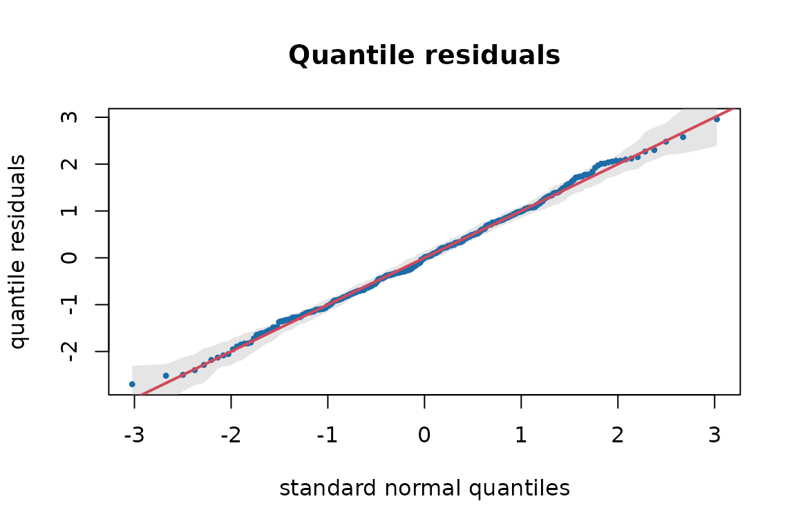

# Getting started with regcompR

regcompR fits distributional regression models: every parameter of a
response distribution can depend on covariates through its own formula.
The same model specification can be fitted by maximum likelihood
(`engine = "ml"`), through TMB (`"tmb"`), or by Bayesian inference in
Stan, JAGS or OpenBUGS (`"bayes"`).

``` r

library(regcompR)
```

## Distributions

Every family lives in a registry that records its support, parameters,
links, moments and references.

``` r

length(families())
#> [1] 282
head(families("count"), 10)
#>  [1] "bell"                        "beta_negative_binomial"     
#>  [3] "borel"                       "borel_tanner"               
#>  [5] "conway_maxwell_poisson"      "conway_maxwell_poisson_mean"
#>  [7] "delaporte"                   "discrete_compound_poisson"  
#>  [9] "discrete_phase_type"         "discrete_weibull"
d <- distribution("gamma", mu = 2, sigma = 0.5)
prob(d, c(1, 2, 3))
#> [1] 0.3608941 0.3907336 0.1784702
quantile(d, c(0.1, 0.5, 0.9))
#> [1] 0.8723848 1.8360304 3.3403915
plot(d)
```


## A first regression

The first formula is the main formula (it models the mean parameter, or
the location or scale parameter where there is no mean). Further
formulas name the parameter on their left side.

``` r

n <- 400
dat <- data.frame(x = runif(n), z = rnorm(n))
dat$y <- rgamma(n, shape = 1 / (0.3 + 0.4 * dat$x)^2,
                scale = exp(1 + dat$x) * (0.3 + 0.4 * dat$x)^2)
fit <- regcomp(y ~ x, sigma ~ x, family = "gamma", data = dat)
summary(fit)
#> <regcomp_fit> Gamma (mean and coefficient of variation, GAMLSS GA) regression, engine 'ml' (frequentist)
#>   mu (log link): ~x
#>   sigma (log link): ~x
#>   log likelihood -834.535 on 4 parameters, n = 400
#> 
#> Wald estimates with 95% confidence intervals:
#>                   estimate std_error   lower   upper        z p_value
#> mu:(Intercept)      0.9264    0.0409  0.8464  1.0065  22.6749       0
#> mu:x                1.1018    0.0915  0.9225  1.2811  12.0425       0
#> sigma:(Intercept)  -1.1440    0.0711 -1.2833 -1.0047 -16.0939       0
#> sigma:x             0.8843    0.1240  0.6413  1.1273   7.1324       0
#> max |gradient| 4.34e-06; Hessian positive definite
```

## Specifying the model

- `links =` changes the link of a parameter
  ([`links()`](https://adamrsophie.github.io/regcompR/reference/link.md)
  lists them);
- `fixed =` holds a parameter at a known value;
- `weights =` multiplies each log likelihood contribution;
- `subset =` selects rows (a logical or index vector);
- data parameters (trial counts, known minima) are given by name, as
  `size = n` for the binomial;
- [`offset()`](https://rdrr.io/r/stats/offset.html) enters a term with
  coefficient one;
- `parameterization =` chooses among parameterizations of a law
  (`get_family("gamma", "rate")`);
- `y ~ .` uses every other column.

``` r

f_link <- regcomp(y ~ x, sigma ~ 1, family = "gamma", data = dat, links = list(mu = "identity"))
f_fix <- regcomp(y ~ x, family = "gamma", data = dat, fixed = list(sigma = 0.5))
f_sub <- regcomp(y ~ x, family = "gamma", data = dat, subset = dat$x > 0.2, weights = rep(2, n))
f_rate <- regcomp(y ~ x, family = "gamma", parameterization = "rate", data = dat)
names(coef(f_rate))
#> [1] "shape:(Intercept)" "rate:(Intercept)"  "rate:x"
bd <- data.frame(n = rpois(50, 10) + 1, x = rnorm(50))
bd$k <- rbinom(50, bd$n, plogis(0.3 * bd$x))
coef(regcomp(k ~ x, family = "binomial", size = n, data = bd))
#> prob:(Intercept)           prob:x 
#>       0.08711978       0.48937544
```

Rows with a missing or non finite value in anything the model evaluates
(the response, a transformed covariate such as `log(x)`, a weight or a
data parameter) are left out, as with
[`glm()`](https://rdrr.io/r/stats/glm.html). The fit stores its analysis
rows, and cross validation and clustered covariances use exactly those
rows.

``` r

dm <- dat; dm$x[3] <- NA; dm$z[5] <- -1
fm <- regcomp(y ~ x + log(z + 1), family = "gamma", data = dm)
nobs(fm)
#> [1] 334
head(fm$rows)
#> [1] 1 2 4 6 7 8
```

[`regcomp_control()`](https://adamrsophie.github.io/regcompR/reference/regcomp_control.md)
sets the optimizer (`maxit`, `rel_tol`, `restarts`, `start` values), the
Laplace inner problem, the proximal solver of lasso type penalties and
the MCMC settings.

``` r

f_ctl <- regcomp(y ~ x, family = "gamma", data = dat,
                 control = regcomp_control(restarts = 2, start = list(mu = c(1, 1))))
f_ctl$diagnostics[c("converged", "max_abs_gradient")]
#> $converged
#> [1] TRUE
#> 
#> $max_abs_gradient
#> [1] 0.0005456312
```

## Methods for fitted models

``` r

coef(fit)
#>    mu:(Intercept)              mu:x sigma:(Intercept)           sigma:x 
#>         0.9264462         1.1017963        -1.1440085         0.8843013
sqrt(diag(vcov(fit)))
#>    mu:(Intercept)              mu:x sigma:(Intercept)           sigma:x 
#>        0.04085773        0.09149227        0.07108316        0.12398398
confint(fit)
#>                        lower     upper
#> mu:(Intercept)     0.8463666  1.006526
#> mu:x               0.9224747  1.281118
#> sigma:(Intercept) -1.2833289 -1.004688
#> sigma:x            0.6412972  1.127305
logLik(fit); AIC(fit); BIC(fit); nobs(fit)
#> 'log Lik.' -834.5354 (df=4)
#> [1] 1677.071
#> [1] 1693.037
#> [1] 400
formula(fit)
#> $mu
#> y ~ x
#> 
#> $sigma
#> sigma ~ x
#> 
#> attr(,"given")
#> [1] "mu"    "sigma"
head(fitted(fit))
#>        1        2        3        4        5        6 
#> 3.383744 3.805514 4.747480 6.869602 3.153959 6.795691
```

[`residuals()`](https://rdrr.io/r/stats/residuals.html) gives randomized
quantile (`"quantile"`, the default), `"pit"`, `"response"` and
`"pearson"` residuals.

``` r

sapply(c("quantile", "pit", "response", "pearson"), function(t) round(head(residuals(fit, type = t), 3), 3))
#>      quantile   pit response pearson
#> [1,]   -0.320 0.375   -0.585  -0.429
#> [2,]    0.450 0.674    0.534   0.317
#> [3,]    0.935 0.825    2.181   0.869
```

## Predictions

[`predict()`](https://rdrr.io/r/stats/predict.html) returns the
distribution parameters (`"parameter"`), the linear predictors
(`"link"`), `"mean"`, `"variance"`, `"sd"`, `"median"`, `"quantile"`,
`"probability"` (mass or density at `at`), `"density"`, `"cdf"` and
`"survival"`, with optional confidence intervals.

``` r

nd <- data.frame(x = c(0.1, 0.5, 0.9))
predict(fit, nd, type = "parameter")
#>         mu     sigma
#> 1 2.819687 0.3479911
#> 2 4.381295 0.4956636
#> 3 6.807758 0.7060019
predict(fit, nd, type = "link")
#>         mu      sigma
#> 1 1.036626 -1.0555783
#> 2 1.477344 -0.7018578
#> 3 1.918063 -0.3481373
predict(fit, nd, type = "mean", interval = "confidence")
#>   estimate    lower    upper
#> 1 2.819687 2.630571 3.022294
#> 2 4.381295 4.161368 4.596050
#> 3 6.807758 6.083452 7.530586
predict(fit, nd, type = "variance")
#>          1          2          3 
#>  0.9628044  4.7160572 23.1004285
predict(fit, nd, type = "sd")
#>        1        2        3 
#> 0.981226 2.171648 4.806291
predict(fit, nd, type = "median")
#> [1] 2.706721 4.028190 5.716167
predict(fit, nd, type = "quantile", probs = c(0.05, 0.95))
#>         q0.05     q0.95
#> [1,] 1.421599  4.603350
#> [2,] 1.514725  8.453764
#> [3,] 1.214368 16.131578
predict(fit, nd, type = "density", at = 5)
#>      density(5)
#> [1,] 0.04336816
#> [2,] 0.15196897
#> [3,] 0.09947143
predict(fit, nd, type = "cdf", at = 5)
#>         cdf(5)
#> [1,] 0.9731764
#> [2,] 0.6688594
#> [3,] 0.4313105
predict(fit, nd, type = "survival", at = 5)
#>      survival(5)
#> [1,]   0.0268236
#> [2,]   0.3311406
#> [3,]   0.5686895
```

[`fitted_distribution()`](https://adamrsophie.github.io/regcompR/reference/fitted_distribution.md)
returns the fitted law of each row as a distribution object;
[`simulate()`](https://rdrr.io/r/stats/simulate.html) draws new
responses;
[`log_lik()`](https://adamrsophie.github.io/regcompR/reference/log_lik.md)
gives pointwise log likelihoods.

``` r

fd <- fitted_distribution(fit, nd)
quantile(fd, 0.9)
#> [1]  4.127447  7.291955 13.230405
dim(simulate(fit, nsim = 3))
#> [1] 400   3
head(log_lik(fit))
#> [1] -1.156701 -1.634178 -2.531584 -3.150097 -1.348237 -2.713591
```

## Checking the fit

``` r

plot(fit, which = "qq")
```



``` r

plot(fit, which = "effects", variable = "x", par = "sigma")
```


## Where to go next

- [`vignette("distributions")`](https://adamrsophie.github.io/regcompR/articles/distributions.md):
  the registry and distribution objects.
- [`vignette("operators")`](https://adamrsophie.github.io/regcompR/articles/operators.md):
  inflation, hurdles, mixtures, truncation, generated families and
  custom families.
- [`vignette("count-models")`](https://adamrsophie.github.io/regcompR/articles/count-models.md):
  overdispersion, zeros and the count families.
- [`vignette("hierarchical-longitudinal")`](https://adamrsophie.github.io/regcompR/articles/hierarchical-longitudinal.md):
  random effects, covariance structures, smooth terms, GEE and nonlinear
  (mixed) models.
- [`vignette("ordinal-categorical")`](https://adamrsophie.github.io/regcompR/articles/ordinal-categorical.md):
  ordinal, nominal, bivariate binary and selection models.
- [`vignette("survival")`](https://adamrsophie.github.io/regcompR/articles/survival.md):
  censoring, truncation, cure models, Cox and frailty models and
  discrete time hazards.
- [`vignette("regularization")`](https://adamrsophie.github.io/regcompR/articles/regularization.md):
  penalized and bias reduced estimation.
- [`vignette("model-checking")`](https://adamrsophie.github.io/regcompR/articles/model-checking.md):
  residuals, scoring rules, cross validation and comparison.
- [`vignette("reporting")`](https://adamrsophie.github.io/regcompR/articles/reporting.md):
  regression tables, tidy output and export of tables and plots.
- [`vignette("bayesian")`](https://adamrsophie.github.io/regcompR/articles/bayesian.md):
  priors, generated Stan and BUGS programs and Bayesian fitting.
