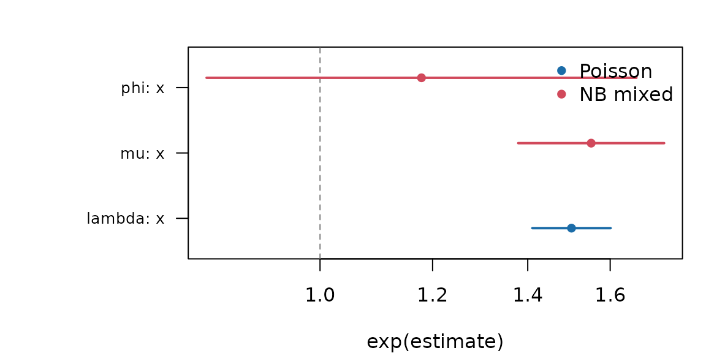

# Reporting results: tables, tidy output and export

``` r

library(regcompR)
n <- 300
d <- data.frame(x = rnorm(n), g = factor(rep(1:30, each = 10)))
d$y <- rnbinom(n, mu = exp(1 + 0.4 * d$x + rnorm(30, 0, 0.4)[d$g]), size = 2)
f1 <- regcomp(y ~ x, family = "poisson", data = d)
f2 <- regcomp(y ~ x + (1 | g), phi ~ x, family = "nb2", data = d)
```

## Regression tables

[`regcomp_table()`](https://adamrsophie.github.io/regcompR/reference/regcomp_table.md)
puts one or several fits side by side. Rows are grouped by distribution
parameter (each parameter has its own regression), random effects are
reported as standard deviations and correlations, and fit statistics
close the table. In a document chunk the table renders as a formatted
HTML, LaTeX or Word table, in R Markdown and Quarto alike:

``` r

tab <- regcomp_table(Poisson = f1, `NB mixed` = f2, exponentiate = TRUE, stars = TRUE)
tab
```

| Parameter | Term | Poisson | NB mixed |
|:---|:---|---:|---:|
| lambda | (Intercept) | 3.121\*\*\* \[2.920, 3.335\] |  |
|  | x | 1.503\*\*\* \[1.410, 1.601\] |  |
| mu | (Intercept) |  | 2.800\*\*\* \[2.308, 3.398\] |
|  | x |  | 1.552\*\*\* \[1.379, 1.746\] |
| phi | (Intercept) |  | 1.952\*\*\* \[1.419, 2.685\] |
|  | x |  | 1.179 \[0.832, 1.669\] |
| mu (random effects) | sd((Intercept) \| g) |  | 0.439 \[0.304, 0.635\] |
|  | nobs | 300 | 300 |
|  | logLik | -850.772 | -671.063 |
|  | AIC | 1705.545 | 1352.125 |
|  | BIC | 1712.952 | 1370.644 |

*95% confidence intervals in brackets; coefficients exponentiated;* p \<
0.05, \*\* p \< 0.01, \*\*\* p \< 0.001.\*

In the console the same object prints as text:

``` r

print(tab)
#>  parameter           term                Poisson                
#>  lambda              (Intercept)         3.121*** [2.920, 3.335]
#>                      x                   1.503*** [1.410, 1.601]
#>  mu                  (Intercept)                                
#>                      x                                          
#>  phi                 (Intercept)                                
#>                      x                                          
#>  mu (random effects) sd((Intercept) | g)                        
#>                      nobs                300                    
#>                      logLik              -850.772               
#>                      AIC                 1705.545               
#>                      BIC                 1712.952               
#>  NB mixed               
#>                         
#>                         
#>  2.800*** [2.308, 3.398]
#>  1.552*** [1.379, 1.746]
#>  1.952*** [1.419, 2.685]
#>  1.179 [0.832, 1.669]   
#>  0.439 [0.304, 0.635]   
#>  300                    
#>  -671.063               
#>  1352.125               
#>  1370.644               
#> 95% confidence intervals in brackets; coefficients exponentiated; * p < 0.05, ** p < 0.01, *** p < 0.001.
```

`show = "se"` gives standard errors instead of intervals; `conf.level`,
`digits` and `stats` control the rest. For Bayesian fits the table shows
posterior means with credible intervals, the number of draws and the
largest R-hat.

``` r

regcomp_table(f1, f2, show = "se", stats = c("nobs", "AIC"))
```

[TABLE]

*Standard errors in parentheses.*

`standardize = TRUE` reports each coefficient per standard deviation of
its covariate, and `vcov = "sandwich"` or `"quasi"` changes the standard
errors.
[`coef_plot()`](https://adamrsophie.github.io/regcompR/reference/coef_plot.md)
draws the estimates of several fits side by side:

``` r

coef_plot(Poisson = f1, `NB mixed` = f2, exponentiate = TRUE)
```



## Tidy output

`tidy()`, `glance()` and `augment()` methods follow the broom
conventions, so every package built on them works with regcompR fits:
broom, modelsummary, gtsummary, and others. `tidy()` adds a `component`
column naming the distribution parameter.

``` r

broom::tidy(f2)
#>                  term component   effect  estimate  std.error  statistic
#> 1         (Intercept)        mu    fixed 1.0296418 0.09871379 10.4305774
#> 2                   x        mu    fixed 0.4392359 0.06031686  7.2821413
#> 3         (Intercept)       phi    fixed 0.6688331 0.16266095  4.1118233
#> 4                   x       phi    fixed 0.1643357 0.17762490  0.9251839
#> 5 sd((Intercept) | g)        mu ran_pars 0.4391203 0.08262669         NA
#>        p.value   conf.low conf.high
#> 1 1.797925e-25  0.8361664 1.2231173
#> 2 3.285626e-13  0.3210170 0.5574548
#> 3 3.925467e-05  0.3500235 0.9876427
#> 4 3.548702e-01 -0.1838027 0.5124741
#> 5           NA  0.3036812 0.6349640
broom::glance(f2)
#>                    family engine nobs df    logLik      AIC      BIC converged
#> 1 Negative binomial (NB2)     ml  300  5 -671.0626 1352.125 1370.644      TRUE
head(broom::augment(f1))
#>            x g  y  .fitted     .resid
#> 1 -0.6264538 1  2 2.417733 -0.3964724
#> 2  0.1836433 1  1 3.362941 -1.1937441
#> 3 -0.8356286 1  1 2.220261 -0.9405229
#> 4  1.5952808 1 10 5.976489  1.4739566
#> 5  0.3295078 1  1 3.568810 -1.3735230
#> 6 -0.8204684 1  2 2.234014 -0.1545081
```

``` r

modelsummary::modelsummary(list(Poisson = f1, NB = f2), shape = term + component ~ model,
                           output = "markdown")
```

## Export

[`export_table()`](https://adamrsophie.github.io/regcompR/reference/export_table.md)
writes a table, a fit or a list of fits to a file whose format follows
the extension: `.csv`, `.html`, `.tex`, `.md` or `.docx` (Word, with the
flextable package).
[`export_plot()`](https://adamrsophie.github.io/regcompR/reference/export_table.md)
saves any diagnostic plot as `.png`, `.jpeg`, `.tiff`, `.pdf` or `.svg`.

``` r

out <- tempdir()
export_table(tab, file.path(out, "models.html"))
export_table(list(f1, f2), file.path(out, "models.csv"), show = "se")
export_plot(f2, file.path(out, "qq.png"), which = "qq", width = 6, height = 4)
list.files(out, pattern = "models|qq")
#> [1] "models.csv"  "models.html" "qq.png"
```
